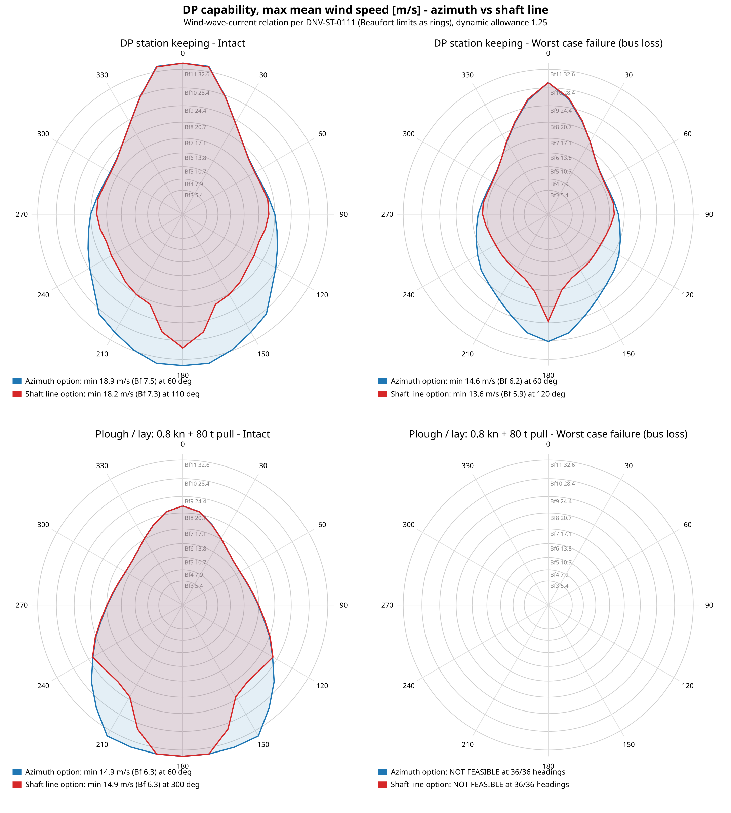
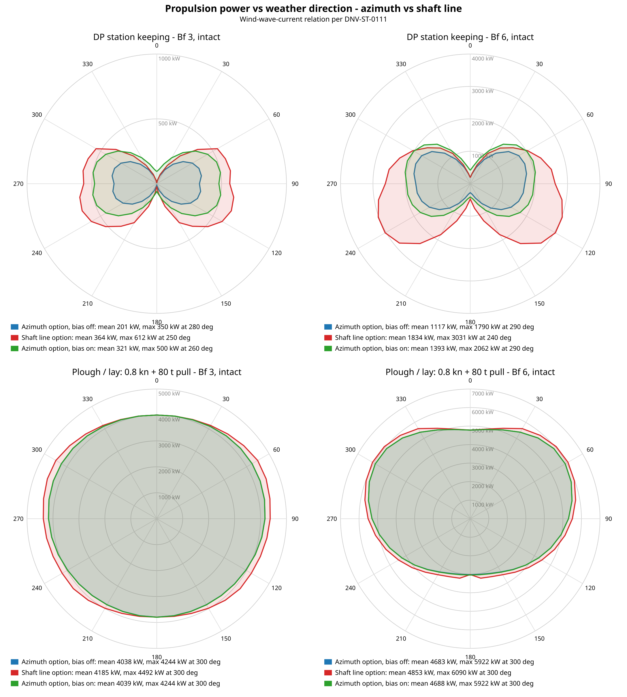

#+TITLE:
#+OPTIONS: title:nil toc:nil num:t H:3 ^:{}
#+LATEX_CLASS: article
#+LATEX_CLASS_OPTIONS: [a4paper,11pt]
#+LATEX_HEADER: % --- Document metadata (must precede bv.sty which uses them in \hypersetup) ---
#+LATEX_HEADER: \newcommand{\bvReferenceNumber}{XXXXXX}
#+LATEX_HEADER: \newcommand{\bvIssue}{Pre}
#+LATEX_HEADER: \newcommand{\bvTitle}{Cable Lay Vessel -- Azimuth vs Shaft Line Propulsion Comparison}
#+LATEX_HEADER: \newcommand{\bvDate}{\today}
#+LATEX_HEADER: \newcommand{\bvType}{Technical Report}
#+LATEX_HEADER: \newcommand{\bvAuthor}{Frode Bloch}
#+LATEX_HEADER: \newcommand{\bvCompany}{Brunvoll AS}
#+LATEX_HEADER: \newcommand{\bvClassification}{COMMERCIAL IN CONFIDENCE}
#+LATEX_HEADER: \usepackage{/home/blofro/src/rdt_analysis/bv}
#+LATEX_HEADER: \usepackage{siunitx}
#+LATEX_HEADER: \sisetup{per-mode=symbol, inter-unit-product=\ensuremath{\cdot}}
#+LATEX_HEADER: \DeclareSIUnit{\knot}{kn}
#+LATEX_HEADER: \usepackage{amsmath}
#+LATEX_HEADER: \graphicspath{{images/}{results/}}

#+BEGIN_EXPORT latex
\bvMainTitlePage
\tableofcontents
\newpage
#+END_EXPORT

* Introduction

This report compares two propulsion configurations for a 6000 t DP class 2 cable lay
vessel (CLV), in operation and in transit.  The two configurations are:

#+ATTR_LATEX: :booktabs t :align lll
| Unit                     | Option 1: Azimuth                     | Option 2: Shaft line                         |
|--------------------------+---------------------------------------+----------------------------------------------|
| Main propulsion          | 2 x 3000 kW azimuth, D 3.3 m, ducted | 2 x 3000 kW shaft line, D 3.0 m, ducted      |
| Steering                 | (azimuth)                             | 2 x flap rudder, 6.9 m$^2$                     |
| Stern tunnel thrusters   | --                                    | 2 x 1500 kW, D 1.5 m                         |
| Bow tunnel thrusters     | 2 x 1700 kW, D 2.6 m                 | 2 x 1700 kW, D 2.6 m                         |
| Bow retractable thruster | 1 x 1600 kW, D 2.4 m                 | 1 x 1600 kW, D 2.4 m                         |

Both main propulsion options are modelled as *fixed pitch propellers with variable
speed electric motors*.

The comparison covers:
1. Static DP capability (DNV-ST-0111 environment), intact and after worst case
   failure, for DP station keeping and for ploughing / cable lay.
2. Propulsion power in operation at fixed weather (Beaufort 3 and 6), intact.
3. Propulsion power in transit, 8--12 kn, calm water and Beaufort 5 head weather.

All calculations are made with the BruCon DP models (thrust allocation, vessel
model, wave drift) and study drivers written for this comparison.

* Models and assumptions

** Vessel and power system
- Reference hull of an existing offshore vessel of similar size:

#+ATTR_LATEX: :booktabs t :align lr
| Main dimension                   | Value        |
|----------------------------------+--------------|
| Length between perpendiculars    | 101.1 m      |
| Length overall                   | 111.5 m      |
| Breadth                          | 22.4 m       |
| Draft                            | 6.5 m        |
| Block coefficient                | 0.74         |
| Displacement                     | about 11100 t |
| Lateral / frontal wind area      | 1755 / 700 m$^2$ |

- Wind forces by Blendermann's method (Blendermann 1994, 2013) with the coefficients
  for an offshore supply vessel (transverse drag 0.90, longitudinal drag 0.55 head /
  0.80 stern, cross-force parameter 0.55), lateral and frontal wind areas as above.
- Wave drift forces from strip theory (PdStrip) response functions, mean drift by
  Newman's approximation.  Current forces from the section based hull model.
- The same hull is used for both options, so the comparison isolates the propulsion.
  In reality a shaft line hull would have a somewhat finer stern.
- Three-split power system (port / centre / starboard switchboard, bus ties),
  4 x 3600 kW generators on port and starboard buses, 2.9 MW ESS on the centre bus.
  Identical for both options.
- Thrusters per bus:

#+ATTR_LATEX: :booktabs t :align lll
| Bus       | Azimuth option           | Shaft line option                        |
|-----------+--------------------------+------------------------------------------|
| Port      | Bow tunnel 1, azimuth 1  | Bow tunnel 1, stern tunnel 1, main prop 1 |
| Centre    | Bow retractable          | Bow retractable                          |
| Starboard | Bow tunnel 2, azimuth 2  | Bow tunnel 2, stern tunnel 2, main prop 2 |

** Thrusters (DP and ploughing)

Table [[tab:thrusters]] lists the thrusters with the assumed net bollard thrust used in
the DP and ploughing calculations, and their positions: $x$ from midship ($L_{pp}/2$),
positive forward; $y$ from the centre line, positive to starboard ($\mp$: port / starboard unit).

#+NAME: tab:thrusters
#+CAPTION: Thrusters, assumed net bollard thrust and positions.  $T_+$: ahead (tunnels: to starboard).  $T_-$: astern (tunnels: to port).  Azimuths give $T_+$ in any direction.
#+ATTR_LATEX: :booktabs t :align lllrrrrrr :placement [H] :font \small
| Option     | Unit                  | Type            | D [m] | P [kW] | $T_+$ [kN] | $T_-$ [kN] | x [m] | y [m] |
|------------+-----------------------+-----------------+-------+------------+--------------------------+---------------------------+-------+-------|
| Both       | Bow tunnel 1          | Tunnel          |   2.6 |       1700 |                      244 |                       244 |  42.8 |   0.0 |
| Both       | Bow tunnel 2          | Tunnel          |   2.6 |       1700 |                      244 |                       244 |  38.6 |   0.0 |
| Both       | Bow retractable       | Azimuth, ducted |   2.4 |       1600 |                      307 |                        -- |  34.0 |   0.0 |
| Azimuth    | Port / stbd azimuth   | Azimuth, ducted |   3.3 |       3000 |                      459 |                        -- | -48.1 | $\mp$ 5.4 |
| Shaft line | Stern tunnel 1        | Tunnel          |   1.5 |       1500 |                      101 |                       101 | -38.7 |   0.0 |
| Shaft line | Stern tunnel 2        | Tunnel          |   1.5 |       1500 |                      101 |                       101 | -41.5 |   0.0 |
| Shaft line | Port / stbd main prop. | FPP, ducted    |   3.0 |       3000 |                      459 |                       275 | -46.0 | $\mp$ 4.5 |
| Shaft line | Port / stbd rudder    | Flap, 6.9 m$^2$   |    -- |         -- |                       -- |                        -- | -48.5 | $\mp$ 4.5 |

- Main propulsors: simple fixed pitch thrust / power model at low speed.  Net bollard
  thrust 459 kN per unit at 3000 kW for *both* options.  This assumes the ship designer
  has aimed for equal bollard pull, the larger azimuth propeller compensating for gear
  housing, strut and hull interaction losses.  For the shaft line the value is the
  D-series fixed pitch bollard design (540 kN gross) times $(1-t)$ with $t$ = 0.15.
- Astern: shaft line reversing at 60 per cent of ahead thrust (to be confirmed).  The
  azimuths are not reversed; they rotate.
- Azimuth thruster--thruster forbidden sectors of 60 deg (wash onto the other azimuth).
- Stern tunnels: 35 per cent thrust loss due to stern tube blockage, 101 kN per unit
  (30--40 per cent is typical; the result is insensitive within that range).
- Bow tunnels and retractable: estimates scaled from reference thrusters by power and
  diameter.
- Rudder side force from the BruCon rudder / slipstream model (flap rudders, 45 deg
  max angle, 3.2 m height).
- Thrust bias (azimuth pair pushing against each other) off, unless stated.

** Environment (DNV-ST-0111)
- Wind, wave and current relation from DNV-ST-0111 Table 2-1, collinear.  Beaufort
  values between the table points are interpolated linearly in wind speed.
- Wave drift from a Pierson--Moskowitz (Bretschneider) spectrum with $\cos^2$
  spreading (Section 3.3.3), $T_p$ as tabulated.
- Dynamic allowance 1.25 on the environmental forces in the capability analysis.
  Operational loads (tow force, own-speed resistance) are not factored.  No dynamic
  allowance in the power calculations (mean power).
- The analysis is not a formal ST-0111 Level 1 rating: the thruster modelling and
  thrust allocation are vessel specific (BruCon allocator).

** Operation modes and failure cases
- *DP station keeping*: zero speed.
- *Ploughing / cable lay*: 0.8 kn ahead through the water and an 80 t (785 kN) pull
  acting astern on the centre line.
- *Worst case failure (WCF)*: loss of one switchboard (port, centre or starboard).  The
  thrusters on that bus are lost, the remaining buses run as separate groups limited by
  their own generators.  The WCF curve is, per heading, the lowest of the three bus losses.

* DP capability

Figure [[fig:capability]] shows the maximum mean wind speed that can be held as a
function of the weather direction relative to the bow, with the Beaufort upper limits
from DNV-ST-0111 as rings.  Table [[tab:capability]] summarises the results.  The search
is limited to 40 m/s.

#+NAME: fig:capability
#+CAPTION: DP capability, maximum mean wind speed held versus weather direction (0 deg = head weather).  Top: DP station keeping.  Bottom: ploughing / cable lay, 0.8 kn and 80 t pull.  Left: intact.  Right: worst case failure.
#+ATTR_LATEX: :width \textwidth :placement [H]

#+NAME: tab:capability
#+CAPTION: DP capability, wind speed in m/s (interpolated Beaufort in brackets).  Stern sector = lowest value with weather from 120--240 deg.
#+ATTR_LATEX: :booktabs t :align llrrrr :placement [H]
| Mode          | Case   | Azimuth min   | Shaft line min | Azimuth stern sector | Shaft line stern sector |
|---------------+--------+---------------+----------------+----------------------+-------------------------|
| Station keep. | Intact | 18.9 (7.5)    | 18.2 (7.3)     | 24.1 (8.9)           | 18.5 (7.4)              |
| Station keep. | WCF    | 14.6 (6.2)    | 13.6 (5.9)     | 18.3 (7.3)           | 13.6 (5.9)              |
| Ploughing     | Intact | 14.9 (6.3)    | 14.9 (6.3)     | 23.3 (8.7)           | 22.6 (8.5)              |
| Ploughing     | WCF    | not feasible  | not feasible   | --                   | --                      |

Observations:
- For weather from ahead and forward of the beam the capability is similar for both
  options, limited by the bow thrusters at about 60 deg off the bow.
- For weather from aft of the beam and the stern quarters (120--240 deg) the azimuth
  option is significantly better.  Intact it holds about 5 m/s more wind, and after
  WCF about 4.7 m/s more (Bf 7.3 against 5.9).  After a bus loss the azimuth option
  keeps a full azimuth at the stern, while the shaft line option has one propeller with
  rudder and one small, partly blocked stern tunnel.
- Ploughing intact is limited by the forward thrust needed for the 80 t pull and is
  equal for both options (equal bollard pull by assumption).
- Ploughing after WCF is not feasible for either option: after a bus loss about 78 t
  is available in calm water.  In practice the operation would be stopped after a
  WCF, and the focus is station keeping while ending the operation, so this case
  mainly illustrates the missing thrust reserve.

* Power consumption in operation

Figure [[fig:power]] shows the propulsion power (propeller shaft power, all thrusters)
at fixed weather, Beaufort 3 and 6, as a function of the weather direction.  The
azimuth option is shown with thrust bias off and on.  Table [[tab:power]] gives the power
for selected weather directions.

#+NAME: fig:power
#+CAPTION: Propulsion power versus weather direction, intact.  Top: DP station keeping.  Bottom: ploughing / cable lay.  Left: Beaufort 3.  Right: Beaufort 6.
#+ATTR_LATEX: :width \textwidth :placement [H]

#+NAME: tab:power
#+CAPTION: Propulsion power, intact, kW, for selected weather directions relative to the bow (results are symmetric port / starboard).
#+ATTR_LATEX: :booktabs t :align lllrrrrr :placement [H]
| Mode          | Weather | Option             | 0 deg | 60 deg | 90 deg | 120 deg | 180 deg |
|---------------+---------+--------------------+-------+--------+--------+---------+---------|
| Station keep. | Bf 3    | Azimuth, bias off  |     5 |    317 |    329 |     300 |      13 |
|               |         | Azimuth, bias on   |    94 |    454 |    479 |     452 |      61 |
|               |         | Shaft line         |     5 |    540 |    563 |     582 |      21 |
| Station keep. | Bf 6    | Azimuth, bias off  |   189 |   1730 |   1680 |    1453 |     277 |
|               |         | Azimuth, bias on   |   414 |   2011 |   1964 |    1777 |     410 |
|               |         | Shaft line         |   189 |   2039 |   2618 |    3031 |     473 |
| Ploughing     | Bf 3    | Azimuth            |  3998 |   4244 |   4173 |    3969 |    3796 |
|               |         | Shaft line         |  3998 |   4492 |   4373 |    4210 |    3796 |
| Ploughing     | Bf 6    | Azimuth            |  4782 |   5922 |   5302 |    4249 |    3016 |
|               |         | Shaft line         |  4782 |   6090 |   5511 |    4465 |    3016 |

Observations:
- Station keeping: with head and stern weather little power is needed and the options
  are similar.  With beam weather and weather aft of the beam the shaft line option
  needs clearly more power, as it must combine propeller, rudder and the small stern
  tunnels.  At Bf 6 with weather from 120 deg the shaft line needs about 3000 kW,
  against about 1450 kW (bias off) and 1780 kW (bias on) for the azimuth option.
- Thrust bias costs the azimuth option up to about 300 kW.  With bias on it is still
  below the shaft line, except with head weather and with stern weather at Bf 3 where
  the power is low anyway.
- Ploughing: the 80 t pull dominates.  With head and stern weather the power is equal;
  with weather on the bow and beam the shaft line needs 3--6 per cent more, as the
  azimuths take the side forces by angling the thrust while pushing.  Bias has no
  effect in ploughing.
- Motor, converter and gear losses are not included, and the thrust / power model is
  a simple relation.  The relative differences are more reliable than absolute values.

* Transit power

The transit power is calculated with a separate model: calm water resistance
(ITTC-57 friction, form factor 1.3, Holtrop--Mennen wave making), appendage and
tunnel opening drag, and for Beaufort 5 head weather the wind force (Blendermann) and
wave drift (strip theory).
The main propellers are modelled as ducted fixed pitch propellers (D-series at design
pitch), with two design philosophies, as the ship designer has not specified this:

- *A, bollard design*: pitch for maximum bollard thrust at 3000 kW; in transit the
  propeller is light, and motor overspeed (20 per cent) is allowed.
- *B, transit design*: pitch for maximum speed at 3000 kW (calm water + 15 per cent
  margin); torque limited at bollard, about 10 per cent lower bollard thrust.

#+ATTR_LATEX: :booktabs t :align lrr
| Coefficient               | Azimuth                  | Shaft line                        |
|---------------------------+--------------------------+-----------------------------------|
| Wake fraction $w$         | 0.10                     | 0.20                              |
| Thrust deduction $t$      | 0.10                     | 0.15                              |
| Transmission efficiency   | 0.97 (angle gears)       | 0.99                              |
| Appendages                | struts, gear housings    | rudders, shafts, brackets, tunnels |

#+CAPTION: Transit, total propulsion motor power for both units, kW.
#+ATTR_LATEX: :booktabs t :align llrrrr :placement [H]
| Condition | Speed | Azimuth A | Azimuth B | Shaft line A | Shaft line B |
|-----------+-------+-----------+-----------+--------------+--------------|
| Calm      | 8 kn  | 608       | 569       | 534          | 511          |
| Calm      | 10 kn | 1182      | 1105      | 1037         | 991          |
| Calm      | 12 kn | 2106      | 1972      | 1859         | 1779         |
| Bf 5 head | 8 kn  | 1207      | 1166      | 1166         | 1152         |
| Bf 5 head | 10 kn | 2006      | 1924      | 1906         | 1870         |
| Bf 5 head | 12 kn | 3203      | 3063      | 3015         | 2947         |

Observations:
- In calm water the shaft line option needs about 10--12 per cent less power; in
  Bf 5 head weather the difference is 1--5 per cent.
- Most of the calm water difference comes from the assumed hull efficiency
  $(1-t)/(1-w)$ (about 6 per cent) and gear efficiency (about 2 per cent).  These are
  estimates; the difference is of the same order as the uncertainty in the inputs.
- The transit design (B) saves 4--7 per cent in calm water compared with the bollard
  design (A), at the cost of about 10 per cent bollard thrust.  Top speed is about
  16 kn for all variants.

* Conclusions

- With equal bollard pull, the two options are close in the headline numbers: lowest
  DP capability, ploughing capability and transit power are within about half a
  Beaufort number or 10 per cent.
- The main difference is the *stern-wise capability*: with weather from the stern
  quarters the azimuth option holds about 5 m/s more wind, both intact and after worst
  case failure (after WCF Bf 7.3 against 5.9).  For a CLV, which has to follow the
  cable route and cannot freely choose heading, this gives a larger operating window.
- The azimuth option uses less power in DP station keeping with beam and stern quarter
  weather (at Bf 6 about 35--50 per cent less with bias off, 25--40 per cent with bias
  on), and slightly less in ploughing (up to about 6 per cent).
- The shaft line option needs about 10 per cent less power in calm water transit,
  less in weather; this depends mainly on uncertain propulsive coefficients.
- Effects not captured by a static analysis, such as faster thrust response, no
  dependence of side force on propeller thrust, and thrust losses of the stern
  tunnels in current, all favour the azimuth option in practice.
- Whether the stern-wise capability and lower DP power outweigh the transit power,
  cost and maintenance aspects is a question for the operator.

* Open points and inputs needed

- Net bollard thrust of the azimuths including gear housing, strut and hull
  interaction losses (here set equal to the shaft line).
- Wake fraction, thrust deduction and gear efficiency for both options.
- Astern thrust of the reversing fixed pitch shaft line propellers (here 60 per cent),
  and four-quadrant data for ducted fixed pitch propellers.
- Stern tunnel thrust including stern tube blockage.
- Hull lines and strip theory data of the actual vessel (reference hull used here).
- Operating profile (time in transit / DP / ploughing) and site weather statistics,
  to express the difference as operability and annual energy.

* Notes on the calculation tools

During the study an error was found in the BruCon thrust allocation: for a twin main
propeller / rudder vessel with one main propeller lost, the side force given to the
remaining propeller and rudder was not realised when a bow azimuth was present.  This
is fixed in BruCon issue 13044 (branch =13044-dp-allocation-for-twin-main-...=), and the results in this report are made with the fix.

The configurations, study drivers, plot script and results are stored in
=hydro_tools/cablelay_propulsion=, see =README.md= there for how to reproduce.
