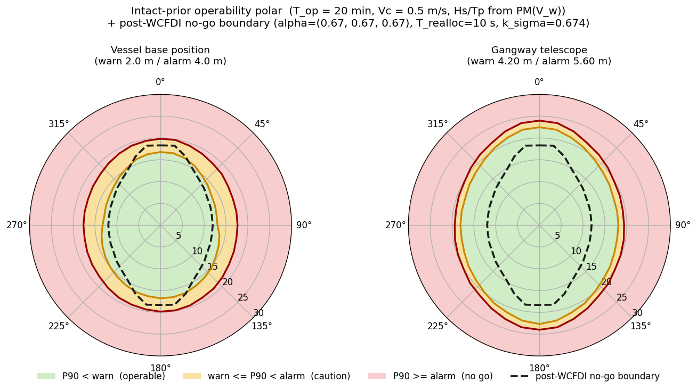
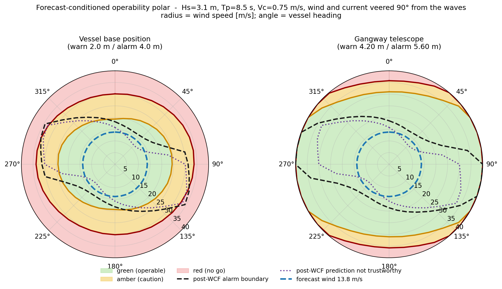
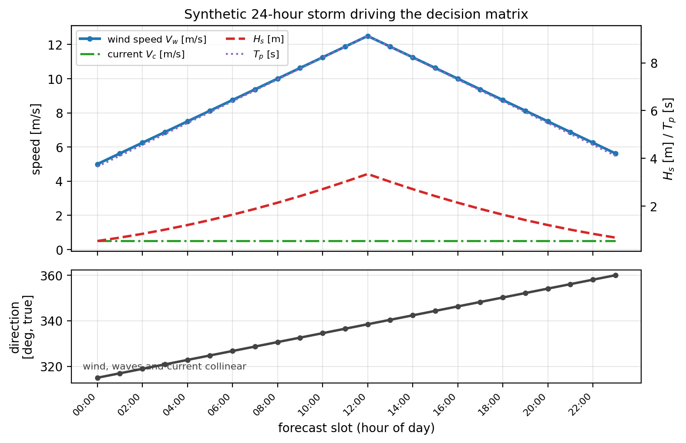
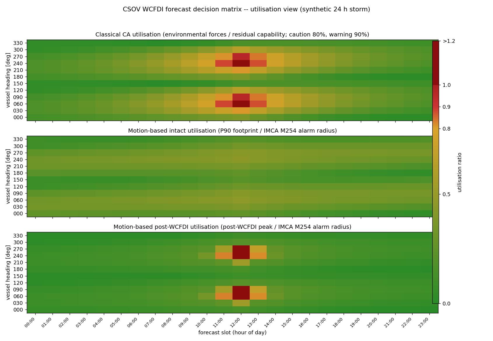
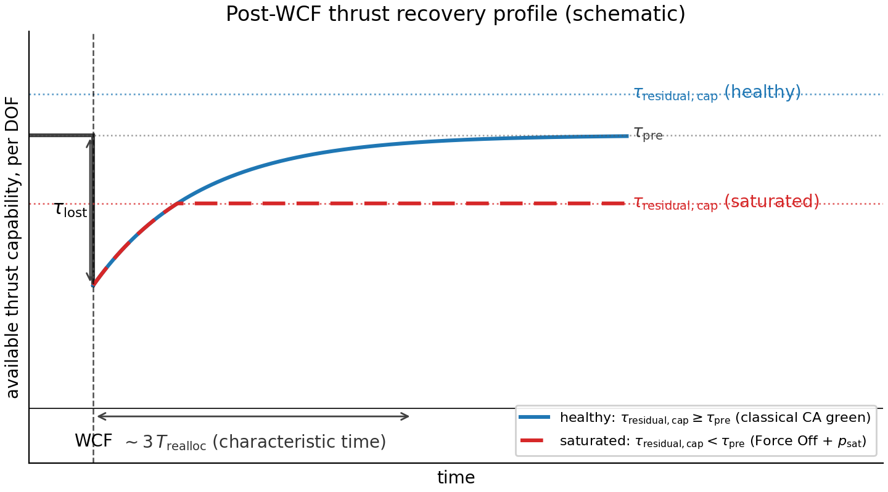
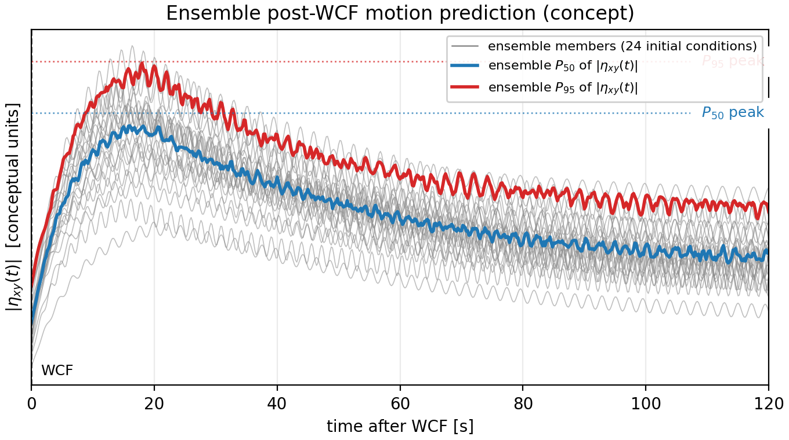
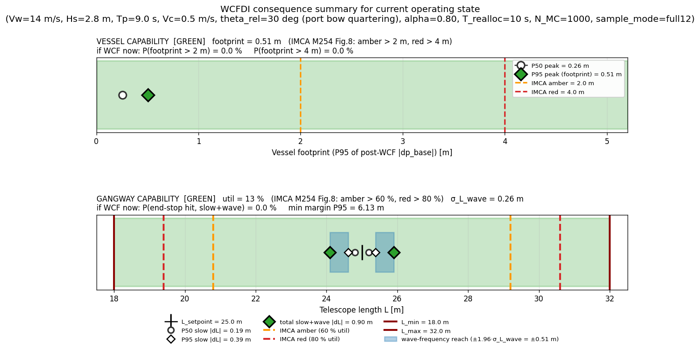
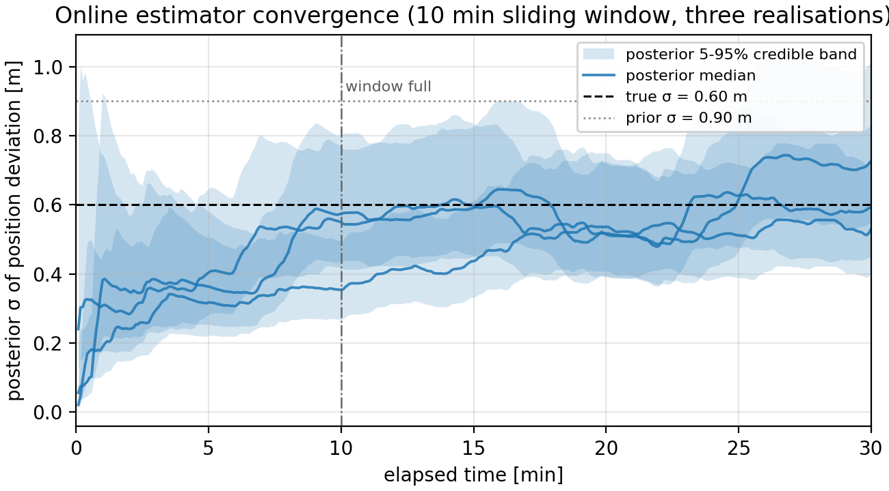
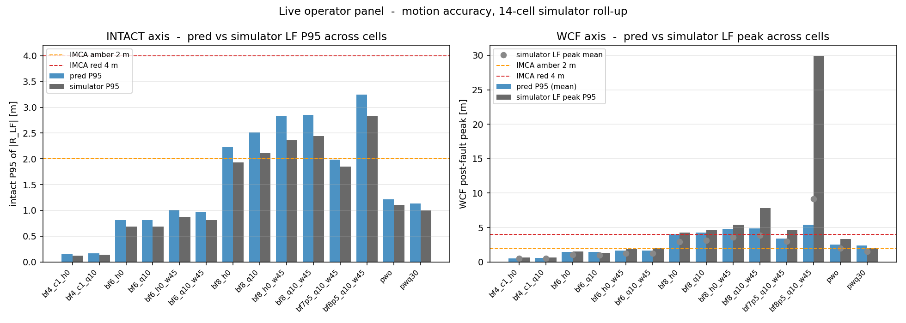
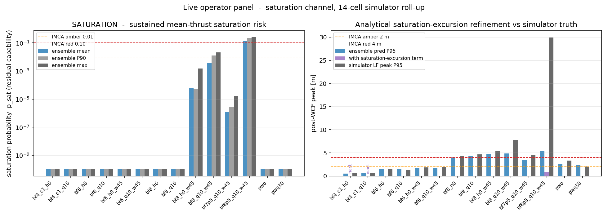

#+OPTIONS: toc:nil
#+OPTIONS: num:nil
#+OPTIONS: ^:nil
#+CITE_EXPORT: natbib
#+BIBLIOGRAPHY: references.bib

#+LATEX_HEADER: \usepackage{csvsimple}
#+LATEX_HEADER: \usepackage[numbers,sort&compress]{natbib}
#+LATEX_HEADER: \newcommand*{\mtsDate}{\today}
#+LATEX_HEADER: \newcommand*{\mts}{\today}
#+LATEX_HEADER: \newcommand*{\mtsType}{Predictability through Technology}
#+LATEX_HEADER: \newcommand*{\mtsTitle}{Motion-Based Consequence Analysis: From Pre-Operation Risk Assessment to Live Operational Monitoring}
#+LATEX_HEADER: \newcommand*{\mtsAuthor}{Frode Bloch}
#+LATEX_HEADER: \newcommand*{\mtsCompany}{Brunvoll AS}
#+LATEX_HEADER: \usepackage{mts}
#+LATEX_HEADER: \interfootnotelinepenalty=10000
#+LATEX_HEADER: \title{Motion-Based Consequence Analysis}
#+LATEX_CLASS: article
#+LaTeX_CLASS_OPTIONS: [letterpaper,11pt]
#+LATEX_HEADER: \usepackage[T1]{fontenc}
#+LATEX_HEADER: % Float spacing: default \belowcaptionskip is 0pt, which leaves table
#+LATEX_HEADER: % captions (org places them above the tabular) running straight into
#+LATEX_HEADER: % the header row. Also open up the gap between floats and body text.
#+LATEX_HEADER: \setlength{\belowcaptionskip}{9pt}
#+LATEX_HEADER: \setlength{\textfloatsep}{22pt plus 4pt minus 4pt}
#+LATEX_HEADER: \setlength{\intextsep}{20pt plus 4pt minus 4pt}
# mathptmx removed: mts.sty already loads newtxmath, and mathptmx loaded
# afterwards reverts math to the older Times math font (zptmcm7y), which
# lacks +, parentheses and accent glyphs - they were silently dropped from
# every equation in the paper.
#+LATEX: \mtsMainTitlePage

* Abstract

Current DP rules and guidance specify capability analysis in detail
but treat consequence analysis (CQA) as little more than a periodic
alarm. The prevailing requirement — recompute every five minutes,
raise a flag only once a limit is breached — leaves the operator with
no continuous indication of the probability of exceeding operational
limits, in the intact condition or following a worst-case failure
(WCF), and no view of the motion consequences of such a failure
before it happens. The risk that CQA is meant to manage is inherently
dynamic; the rules treat it as static.

This work develops a motion-based CQA framework that closes that gap
end-to-end. A pre-operation risk assessment extends the conventional
capability analysis with an estimate of vessel response and post-WCF
excursion from the planned sea state, allowing the worst-case failure
design intent to be evaluated in motion terms. The same model
is reformulated for online execution, producing a continuously
updated CQA panel that estimates intact and post-WCF station-keeping
footprint directly from live measurements and the DP model, without a
runtime sea-state input. The panel is further extended to
motion-sensitive mission equipment such as walk-to-work gangways.

Validation against a nonlinear DP simulator is complete; validation
against logged operations is in progress.

* Abbreviations and Definitions

- *CQA* :: Consequence Analysis: the DP-rules-mandated periodic
  computation that flags whether the vessel can maintain position
  after a worst-case failure. Referred to throughout as the
  *classical CQA* where it needs to be distinguished from the
  extension proposed here.
- *Motion-based CQA* :: The extension of the classical CQA proposed
  in this paper, which quantifies the *probability of exceeding
  operational limits*, in both intact and post-WCF conditions,
  continuously and in motion terms.
- *P50 / P90 / P95* :: Percentiles of the predicted maximum motion
  excursion. \(P_{50}\) is the typical value, exceeded in about half
  of operating windows; \(P_{90}\) is exceeded in roughly one window
  in ten; \(P_{95}\) is a conservative value exceeded in one window
  in twenty.
- *WCF* :: Worst-Case Failure: the failure event (typically loss of a
  thruster group or bus section) against which CQA is evaluated, and
  which the vessel is designed to survive.
- *DP model* :: The mathematical model of the vessel used internally in
  the DP control system to estimate the vessel response from the
  combination of thruster action, sensor measurements, and position
  reference measurements. It carries estimates of position, velocity,
  and the slowly varying bias that absorbs the environmental load not
  otherwise modelled.
- *Capability analysis* :: The classical pre-operation deliverable
  computing the achievable envelope of environmental force the vessel
  can hold against.
- *WCF decision matrix* :: A traffic-light forecast of intact and
  post-WCF operability as a function of (vessel heading, forecast
  time), delivered before the operation starts.

* Introduction

Consequence analysis (CQA) has been a requirement for redundant DP
classes for several decades. The IMO consolidated the requirement at
international level in MSC/Circ.645 in 1994 [cite:@imo_msc645], and it
is carried into the class rules [cite:@dnv_ru_ship;@abs_dps] as a
mandatory software function on
DP-2 and DP-3 vessels. Its purpose is straightforward: given the
worst-case failure (WCF) the vessel is designed against, verify
continuously that the DP system as a whole — sensors, thrusters,
power, and control — can withstand the average prevailing
environmental forces after the failure. If it cannot, an alarm is
raised.

That obligation is met today by a periodic force-and-moment reserve
check with alarm-on-breach. The check is defensible: applied with a
percentage capacity margin it keeps the operator comfortably inside
a safe envelope for the majority of operations. What it does not
report is *motion*. The CQA does not indicate how the vessel will
move in the intact condition, how it will move during and after a
WCF, or how mission-sensitive equipment such as walk-to-work
gangways, heave-compensated cranes, and ROV LARS will move with it.
It does not quantify the probability of exceeding operational limits
before those limits are breached. Modern DP operations increasingly
run at sea states where the motion of the vessel or its mission
equipment sits close to operational limits well inside the
capacity-safe envelope, and the operator has no continuous, graded
indication of proximity to those limits.

This paper proposes a *motion-based consequence quality analysis*
(CQA) framework that closes that gap by adding a layer on top of
the current CQA implementation, in two coupled deliverables: a
*pre-operation risk assessment*, evaluating the worst-case failure
design intent in motion terms from the forecast sea state;
and a *live CQA panel*, producing continuously updated \(P_{50}\) /
\(P_{95}\) motion-footprint envelopes for intact and post-WCF
conditions from measurements every DP-2/DP-3 vessel already
publishes. The framework is additive: the current CQA continues to
run and continues to raise its Drift Off / Force Off alarms; the
motion layer adds one new operator alert, *Large Transient*, that
fires when the motion prediction itself should be read as a lower
bound rather than an upper bound. With the motion layer in place
the operator can work closer to the operational limit in a
controlled way, seeing proximity to the limit rather than waiting
for a breach.

The remainder of the paper is organised as follows. Section 2
states the design goals of the framework. Section 3 develops the
pre-operation motion capability analysis. Section 4 develops the
live CQA panel and the two-channel design. Section 5 presents
simulator-based validation on a CSOV benchmark vessel. Section 6
reports the in-progress validation against real operational logs.
Section 7 concludes.

* Goal

The motion-based CQA framework is designed to two operational goals.
Both are stated from the perspective of the operator planning and
running an offshore operation — for example a walk-to-work personnel
transfer or a heave-compensated construction lift — where the
station-keeping capacity is comfortable but the *motion* of vessel
and mission equipment may sit close to the operational limits.

1. *Verify motion limits before the operation.* Before committing to
   the operation, the operator can evaluate whether the planned
   vessel and mission-equipment motion — both in the intact condition
   and following the worst-case failure (WCF) — will stay inside the
   operational limits at the planned sea state, heading, and
   operating window. The classical capability analysis already
   verifies that the DP system has the capacity to hold; the
   motion-based pre-operation risk assessment answers the next
   question, whether the resulting motion is inside the limits that
   actually constrain the operation.

2. *Maintain continuous awareness of the safety margin towards those
   motion limits during the operation.* Once the operation is in
   progress, the operator continuously sees how close the vessel and
   mission-equipment motion sits to the operational limits, both in
   the intact condition and in the post-WCF condition. Rather than
   the binary alarm-on-breach of the classical CQA, the operator reads
   a continuously updated margin: comfortable, closer, at the limit.
   The awareness covers the post-WCF condition explicitly, so the
   operator sees whether the operation is inside the survivable
   motion envelope, not only inside the capacity envelope.

Four design principles support these two goals and are worth stating
briefly up front so the methodology sections that follow can be read
against them. First, *motion-based throughout*: pre-operation and
live outputs are stated in vessel and mission-equipment motion, in
the same units and thresholds the operator already reads on the DP
console. Second, *one model in two regimes*: the same underlying
motion model serves the pre-operation stage (fed by the forecast sea
state) and the live stage (fed by live measurements and the DP
model), so that the operator sees the same numbers before and during
the operation. Third, *readily available measurements only, online*:
the live layer consumes only signals every DP-2/DP-3 vessel already
publishes, plus vessel-constant parameters — no runtime seakeeping
model, no runtime spectral partition, no runtime wave forecast — so
that the design stays defensible under mixed wind-sea and swell,
cross-current forcing, and near-installation shielding. Fourth,
*additive to the classical framework*: the motion layer sits on top
of the classical capability + CQA computation and consumes its
outputs, without replacing or contesting any rule-mandated
behaviour; the classical Drift Off and Force Off alarms remain the
primary hard-failure signals.

* Motion-Based Capability Analysis

** Why motion matters in modern DP operations

Consider a walk-to-work operation transferring personnel to a wind
turbine. Once the gangway has landed, its tip is not free to follow
the vessel: it rests on, or is pressed against, a landing point on
the structure, and is therefore held fixed in the structure's frame.
The vessel motion underneath is absorbed instead by the gangway
mechanism — principally telescope stroke, together with slew. Both
have hard mechanical end-stops. A gangway carries only a limited
amount of stroke between fully extended and fully compressed, and
that stroke budget, shared with the slew envelope, is what sets the
excursion the gangway pedestal — and hence the vessel — can be
allowed before the mechanism runs out of travel and the transfer must
be stopped. IMCA M254 [cite:@imca_m254] sets out
how station-keeping footprint limits should be established for an
operation; the resulting warning and alarm radii are what express
this allowance in a form the DP operator can work to. Throughout
this paper we use 2 m and 4 m as representative warning and alarm
radii for the benchmark vessel. They are illustrative values for
that vessel and gangway, not fixed values: these limits are
vessel-, equipment- and operation-specific and are established per
operation.

The consequence is that the binding limit is a *motion* limit that
sits well inside the capacity-safe envelope. In many sea states the
DP capacity margin against wind, wave, and current is generous and
the classical CQA reports green, yet the transfer stops because the
vessel's motion footprint has consumed the gangway's mechanical
travel. The same picture recurs in heave-compensated construction,
ROV LARS operations, and offshore crane work: the operational limit
is a motion limit on mission-sensitive equipment, not a capacity
limit. The IMCA M254 bands are themselves a motion concept: the
yellow and red station-keeping footprint limits are distances the
vessel must stay within, not percentages of capacity reserve. What a
motion-based pre-operation risk assessment adds is the *probability
of exceeding* them — quantiles of the motion process evaluated
against those limits — for the vessel and, through the same shared
kinematic model, for the mission-equipment quantities the operator
actually cares about, such as telescope stroke.

** High-quality weather forecasts as an enabler

The motion-based pre-operation risk assessment is only defensible
because the meteorological input is now good enough. Modern global
ensemble products such as the ECMWF Integrated Forecasting System
[cite:@ecmwf_ifs] deliver directional wave spectra with useful skill at
24 to 72 hours horizon for the wind-sea component, together with a
probabilistic view from the ensemble spread. Regional hindcast
reanalyses such as NORA3 [cite:@nora3] provide a directional spectrum
climatology at 3 km resolution for the North Sea and Norwegian Sea
that has been extensively validated against buoy measurements and is
a useful cross-check against archived forecasts. Skill on the swell
component and on rapidly evolving weather systems remains the harder
part of the problem, and cross-basin swell propagation and mixed
multi-modal sea states are known weak points; but the forecast
directional spectrum is credible enough that using it as the input to
a motion-response model produces an operationally meaningful envelope
rather than a numerical artefact. The pre-op layer of the framework
treats the forecast directional spectrum as its primary input and
propagates it through the vessel response model described in the
next subsection.

** Method: from forecast sea state to motion envelope

The pre-operation method takes the forecast sea state as input and
produces a motion-footprint envelope — a probability distribution of
peak excursion over the operating window — for both the vessel and
any user-defined point on mission-sensitive equipment. It comprises
five steps.

*a. Vessel-response model.* A 3-DOF linearised model of the DP
station-keeping regime,

\begin{equation}
M \ddot{\eta} + D \dot{\eta} = \tau_{env} + \tau_{c},
\label{eq:vessel-response}
\end{equation}

with \(\eta = (x, y, \psi)^{\top}\) the position and heading deviation
from setpoint, \(M\) the mass and added-mass matrix, \(D\) the linear
damping, \(\tau_{c}\) the DP thrust command from the vessel's own
PID + integrator controller closed around \(\eta\), and
\(\tau_{env}\) the
environmental forcing. Only vessel mass, damping, and controller
tuning are required; a full 6-DOF seakeeping representation is not
used because the pre-op deliverable is a horizontal-plane
station-keeping footprint.

*b. Environmental forcing.* From the forecast directional wave
spectrum, mean wind, and mean current, \(\tau_{env}\) is composed of
three components: the second-order wave-drift force per DOF, obtained
by applying the vessel's quadratic transfer functions (QTFs)
[cite:@pinkster_qtf] to the directional spectrum, and the wind and
current forces, computed with the same models the vessel's DP control
system uses. The wave-drift term dominates the LF driving spectrum;
wind and current appear primarily as bias offsets absorbed by the DP
model.

*c. From \(\tau_{env}\) to motion envelope.* Under Eq.
(\ref{eq:vessel-response}), the intact response has a low-frequency
component driven by wave-drift and wind and a wave-frequency
component driven by first-order wave excitation, both approximately
stationary over the operating window.

What the operator needs from this is the answer to a simple
question: how far is the vessel likely to move, at worst, during the
operation? The quantity of interest is therefore the *maximum
position excursion over a selected operating window* \(R\) — the
largest distance the vessel wanders from its setpoint during,
typically, the next 30 minutes. That maximum is not a fixed number:
it varies from one realisation of the sea state to the next, so the
framework treats it as a random quantity. Characterising it from the
response statistics is standard extreme-value practice for stationary
processes; see Rice [cite:@rice_running_max] and Vanmarcke
[cite:@vanmarcke_bandwidth] for the derivations.

What is then reported is not the distribution itself but the number
the operator can act on: the probability that the excursion exceeds
the warning and alarm limits set for the operation. Alongside it, two
representative excursions give a sense of scale — a typical value,
exceeded in about half of operating windows, and a conservative
value, exceeded in only one window in twenty.

The traffic-light band that decides operable / caution / no-go is set
by comparing a high excursion level against the vessel- and
mission-specific warning and alarm limits established for the
operation. The level used
is the one exceeded in about one operating window in ten, written
\(P_{90}\) in what follows and in the figures; on the same
convention \(P_{50}\) is the typical excursion, exceeded in about
half of operating windows, and \(P_{95}\) a conservative one
exceeded in one window in twenty. The vessel's wave-frequency motion is
combined with the slower drifting motion to give the total
excursion.

*d. Extension to mission equipment.* The same excursion process,
projected through mission-equipment lever arms and coupling
kinematics, gives the motion at any point of interest — a LARS boom
head or crane hook — as a linear combination of vessel translations
and rotations. For a landed gangway the quantity of interest is not
a point motion but the travel the mechanism must absorb to hold the
tip fixed on the structure: the same projection yields the telescope
stroke deviation directly, which is what the mechanical end-stops
constrain. No new random inputs are introduced; vessel and
mission-equipment footprints appear together
in the [[Example: the live operator display][live operator display]].

*e. Note on conservatism.* The extreme-value result is mildly
conservative for a feedback-controlled vessel, because the controller
suppresses the largest excursions the underlying theory allows for.
The predicted excursion therefore comes out somewhat larger than the
vessel actually experiences; the simulation studies quantify the
margin.

** Assumptions

The pre-operation motion model rests on the following explicit
assumptions.

- The sea state is stationary over the operating window, so that
  process statistics (variance, spectral moments) are constant.
- The forecast directional spectrum is representative of the actual
  sea state during the window, within the skill of the forecast
  product used.
- The vessel QTFs, wind coefficients, and current coefficients are
  the design-intent values for the vessel and heading; drift and
  loading variation are absorbed into the framework's conservatism
  margin.
- Forward-speed effects are absent (station-keeping regime): the
  vessel is dynamically holding a setpoint, not transiting.
- The low-frequency and wave-frequency responses are treated as
  statistically independent. They are not merged into a single
  process: each band keeps its own variance and its own crossing
  rate, and it is the expected numbers of limit crossings
  contributed by the two that add. This matters because the two
  bands cross a given level at very different rates, which a single
  merged variance would discard. Where an end-stop is at stake the
  combination is deliberately cruder and more conservative: a
  wave-frequency peak is added directly to the low-frequency level,
  assuming the two coincide.
- The classical capability analysis provides the outer envelope of
  operability. The motion-based envelope produced here is the inner
  envelope: within the capacity-safe outer envelope, the motion
  envelope identifies where operational limits — vessel or mission
  equipment — are first exceeded. The two envelopes are used
  together, not one instead of the other.

** Design operability polar

The framework produces two kinds of polar, answering different
questions. The *design polar* of this subsection sweeps wind speed
with the sea state growing alongside it, and answers whether a given
vessel and thruster layout is suitable for a work scope at all. It is
a design and feasibility chart of the same family as the standard DP
capability plot, not something a navigator reads on the bridge. The
*forecast-conditioned polar* of the next subsection pins the sea
state to a specific forecast and varies only the wind, and is the
operational chart. Both are built from the same motion model.

Figure [[fig:design_polar]] shows the design polar for the CSOV
benchmark vessel introduced in Section 5. At any given vessel heading
and mean wind speed the coloured bands answer whether the operation
is operable (green), in a caution band (amber), or no-go (red) in
terms of the intact motion footprint, and the black dashed contour
adds the post-WCF boundary on the same axes. The colour band is set
by the motion excursion exceeded about one time in ten, compared
against a warning and alarm limit: for the vessel base position
these are the station-keeping radii established for the operation
(here 2.0 m / 4.0 m); for the gangway telescope they are derived from
the mechanism's remaining travel. The benchmark gangway telescopes
between 18 m and 32 m and is landed at mid-stroke, leaving 7 m of
travel in each direction; warning and alarm are set at 60% and 80% of
that remaining travel, giving 4.20 m and 5.60 m. Landing the gangway
off-centre reduces the travel available in one direction and tightens
these thresholds accordingly. The sea state at each polar radius is
generated from the wind speed using the DNV-ST-0111
[cite:@dnv_st_0111] wind-wave correlation for a fully-developed sea,
which is the Pierson-Moskowitz relation, with a Bretschneider
spectrum shape and a fixed current component. The operating window is
20 minutes.

Three features are worth calling out. First, the operable envelopes
are anisotropic: both panels reach further in head and following seas
than in the beam sector, as expected from how environmental force
projects through the vessel geometry. Second, the post-WCF boundary
sits well inside the intact one — in the beam sector it falls to
roughly 15-20 m/s against an intact alarm near 25 m/s — and it is
asymmetric in the same way, tightest on the beam and closest to the
intact envelope head-on. This is the motion equivalent of the tighter
envelope the classical CQA already screens against, expressed in
motion rather than as a capacity-reserve percentage.

Third, the gangway telescope envelope is much the larger of the two,
both intact and after the failure. For this vessel and gangway the
station-keeping limits are the more constraining, so the vessel, not
the gangway, decides when the operation stops. The same polar can be
produced for any other mission-equipment point the operator sets
thresholds for.

#+CAPTION: Design operability polar for the CSOV benchmark vessel and
#+CAPTION: forward walk-to-work gangway. Polar radius is mean wind
#+CAPTION: speed [m/s]; heading is vessel-relative wave direction. The
#+CAPTION: colour band is set by the intact motion excursion exceeded
#+CAPTION: about one time in ten, compared against the vessel and
#+CAPTION: mission-equipment warning and alarm limits. The black dashed
#+CAPTION: contour is the wind speed at which the alarm limit would
#+CAPTION: be exceeded about one time in ten after the worst-case
#+CAPTION: failure.
#+NAME: fig:design_polar
#+ATTR_LATEX: :width 1.0\linewidth

** Forecast-conditioned operability polar

The design polars answer a design question. The operational question
is different: given the sea state actually forecast for the operating
window, which vessel headings work, and how much margin is left on
each? Figure [[fig:forecast_polar]] answers it directly. The wave
condition and the current are pinned at their forecast values and
only the wind speed is swept, so the boundary for each vessel heading
is the wind speed at which the motion limit would be reached in *this*
sea state. The forecast wind speed is drawn as a ring on the same
axes, and the radial gap between that ring and the boundary is the
wind margin the operator has in hand at each heading.

The example is a Beaufort 6 forecast — the nominal DNV-ST-0111
condition, Hs = 3.1 m, Tp = 8.5 s, Vc = 0.75 m/s — with the wind
veered 90\deg{} ahead of a sea that has not yet turned to follow it,
and the tidal stream running with the wind. This is an ordinary
forecast situation rather than a contrived one, and it is what makes
the envelope genuinely asymmetric: the heading that is most
comfortable for the waves is not the one that is most comfortable for
the wind and current.

The operational content is the margin, not the colour. On the vessel
panel the caution boundary ranges from 19.3 m/s to 24.6 m/s across
headings, so against a forecast wind of 13.8 m/s the operator has
between 5.5 and 10.8 m/s of wind in hand depending on how the vessel
is oriented — roughly a factor of two between the tightest heading
and the most open one. An operator reading only a pass / fail
capability check sees "operable" across the whole circle and has no
way to tell that some headings carry twice the margin of others. That
margin is what makes the difference between an operation that absorbs
a forecast busting by a few metres per second and one that does not.

Each panel carries two further contours, and the distinction between
them is the same one the live panel draws. The black dashed curve is
the post-WCF alarm boundary: the wind speed at which the motion after
the worst-case failure would cross the alarm limit. The dotted curve
marks where a *large transient* becomes possible after the failure:
beyond it the post-WCF motion figure should be read as a lower bound
rather than a tight prediction. It is the pre-operation counterpart
of the Large Transient alert on the live panel, reached by a
different computation — a bistability score on the predicted
trajectory here, the saturation probability \(p_{\text{sat}}\)
there — but carrying the same operational meaning.

The two say different things here, and that is the point. On motion
alone the operation is comfortable: the post-WCF alarm boundary does
not fall below 16.0 m/s at any heading, against a forecast wind of
13.8 m/s, so no heading is predicted to breach the envelope. But the
large-transient boundary falls to 11.6 m/s in the worst orientations,
and at 10 of the 36 headings evaluated it sits below the forecast
wind. In those orientations — two sectors around 020-060\deg{} and
200-240\deg{} — the framework is not saying the vessel will exceed
its motion limit after a failure; it is warning that a large
transient is possible and that the predicted motion may therefore be
an underestimate. An operator reading a single number would see a
comfortable margin, with no indication that a quarter of the heading
circle carries that risk.

The two panels also show which limit is actually binding. The gangway
telescope boundary does not fall below 31 m/s at any heading, and at
some orientations the telescope limit is not reached at any wind
speed of interest because the vessel motion barely projects onto the
telescope axis. For this vessel, gangway configuration and forecast
the vessel station-keeping limit binds everywhere and the gangway has
substantial margin behind it — but that is a result of the geometry
rather than a general rule, and a shorter-stroke gangway or an
off-centre landing would move the binding limit. Both limits are
motion limits; the classical force-balance check is a separate
constraint and appears as the top panel of the decision matrix in the
next subsection.

#+CAPTION: Forecast-conditioned operability polar for the CSOV
#+CAPTION: benchmark, vessel base position (left) and gangway
#+CAPTION: telescope (right) on a common scale. Radius is wind speed;
#+CAPTION: the angular coordinate is vessel heading. Contours and
#+CAPTION: colour bands are described in the text. Gangway boundaries
#+CAPTION: beyond the plotted range are clipped at the rim.
#+NAME: fig:forecast_polar
#+ATTR_LATEX: :width 0.86\linewidth :placement [tbp]

** Example: WCF decision matrix

The operability polar of the previous subsection gives a static
picture: for a given sea state, which headings are operable? The
WCF decision matrix (Figure [[fig:decision_matrix]]) puts that
picture on a forecast timeline. Each cell of the matrix is one
(heading, forecast slot) combination; the cell colour is the
utilisation ratio evaluated on the forecast sea state at that time,
using the same green→yellow→red gradient across all three panels so
that different views of operability can be read directly against
each other. The example is driven by a synthetic 24-hour storm.

The forecast driving the example is shown in Figure
[[fig:storm_profile]]: a passing storm with the wind rising from 5
m/s to a 12.5 m/s peak at 12:00 and falling away again, the direction
veering steadily from 315\deg{} to 360\deg{} through the day, and a
constant 0.5 m/s current. Wind, waves and current are collinear, and
the sea state follows the same DNV-ST-0111 wind-wave correlation used
for the design polar, so \(H_s\) and \(T_p\) follow the wind speed.
\(T_p\) is omitted from the figure: the correlation makes it directly
proportional to \(V_w\), so its trace would simply overlay the wind
curve. The
peak is deliberately modest: it keeps the classical CQA comfortably
inside the residual capacity throughout, which is the regime where
the motion layer has something to add.

#+CAPTION: Synthetic 24-hour storm forecast driving the decision
#+CAPTION: matrix. Wind, waves and current are collinear; the sea
#+CAPTION: state follows the DNV-ST-0111 wind-wave correlation, so
#+CAPTION: \(H_s\) tracks the wind speed. \(T_p\) is proportional to
#+CAPTION: \(V_w\) under that correlation and is omitted.
#+NAME: fig:storm_profile
#+ATTR_LATEX: :width 0.82\linewidth :placement [tbp]

The three panels correspond to three different consequence-analysis
questions asked at the same (time, heading) cell:

- *Classical CQA utilisation* (top panel): the ratio of mean
  environmental force to residual (post-WCF) thrust capability,
  per DOF, taken maximum across DOFs. This is what the current
  force-and-moment reserve check that runs on any DP-2/DP-3 vessel
  reports. The operational bands used by the reference DP system are caution at 80%
  utilisation and warning at 90%.
- *Motion-based intact utilisation* (middle panel): the ratio of the
  intact-condition P90 running-maximum footprint to the operation's
  alarm radius. Reaches 1.0 when the intact motion of the vessel
  itself would cross that alarm threshold; the colour scale runs
  caution from 0.50, the warn / alarm ratio, and warning from 1.00.
- *Motion-based post-WCF utilisation* (bottom panel): the same
  ratio computed on the post-WCF motion envelope, i.e. what the
  motion would be if the worst-case failure occurred at that
  (time, heading) cell, on the same 0.50 / 1.00 scale.

The operator's task is to plan a safe operation through the forecast
window. The three panels answer that task in three different ways.
The classical CQA panel identifies the operational constraint the
current rules already enforce: a narrow yellow-orange caution band
and a small red spot at the storm peak (12:00) in the two beam
sectors, driven by the environmental force approaching the residual
capability. An operator running only the classical CQA would read
this as "the storm peak is borderline in beam headings; work around
it and the operation is fine". The motion-based intact panel adds
essentially nothing new here — the vessel motion itself never comes
close to the alarm radius, so the classical CQA plus intact motion
confirms the same operational verdict.

The motion-based post-WCF panel changes the picture. Even though
the classical CQA reports at most yellow-caution across the storm
peak, the motion-based post-WCF utilisation reaches saturation
(dark red, well past the alarm radius) in a narrow ~2-hour window
around 12:00 in the beam headings. Physically, this is the regime
where the storm energy is still comfortably below the vessel's
survivable capacity but the *motion* consequence of a WCF at that
instant would take the vessel outside the operational motion
envelope. Two heading windows around head and following seas
(roughly 150-210° and 330-030°) stay green even at the storm peak.

The operator's plan therefore depends on which panel is authoritative.
On classical CQA alone the plan is "operate through the storm, easing
off around 12:00"; on the motion-based post-WCF panel the plan
becomes "avoid the beam sector 11:00-13:00 window entirely, or use
one of the two green heading windows through it". The 2-hour narrow
red band is the added operational content the motion-based framework
delivers: the *when* and the *which heading* at the resolution the
motion actually constrains, not just the *whether* at the resolution
the residual capacity constrains.

#+CAPTION: WCF forecast decision matrix over a synthetic 24-hour
#+CAPTION: storm for the CSOV benchmark vessel. Rows: vessel heading
#+CAPTION: (deg, true). Columns: forecast slot (hour of day). All
#+CAPTION: three panels share one colour scale, described in the text.
#+NAME: fig:decision_matrix
#+ATTR_LATEX: :width 1.0\linewidth

* Consequence Analysis (Live)

** Positioning: additive to the classical CQA

The live CQA panel runs alongside — not in place of — the classical
CQA required by IMO MSC/Circ.645 [cite:@imo_msc645]. The classical CQA
continues to compute and publish four quantities that the motion
layer subscribes to: the per-WCF-candidate capacity reserve, a
drift-off flag per DOF (the survivor set has zero capability against
the prevailing environmental force in that DOF), a force-off flag
per DOF (the survivor set is available but the prevailing demand
exceeds its cap), and \(\tau_{\text{lost}}\), the vector of thrust
that would be lost in the WCF at each candidate failure. The motion
layer treats these as its inputs, along with the DP model
state (position and velocity deviation \(\eta, \dot{\eta}\); bias
estimate \(\hat{b}\)) and a rolling buffer of the allocator feedback
\(\tau_{\text{fb}}\); it does not duplicate the capacity-reserve
computation and it does not consume any sea-state input at runtime.

\(\tau_{\text{lost}}\) is not an instantaneous loss that stays at
zero: the survivor set is reallocated back toward the pre-failure
demand as fast as the thruster inertia and the allocator update rate
allow. Figure [[fig:tau_recovery]] sketches the profile the motion
layer assumes. At the WCF event, the available thrust capability
magnitude drops instantaneously by \(\tau_{\text{lost}}\), of which
an immediately recovered fraction \(\gamma_{\text{imm}}\) is picked
up straight away by the survivor set. From that step the survivor
allocator then recovers the remaining shortfall exponentially with
characteristic time \(T_{\text{realloc}}\), asymptoting to one of
two targets. In the *healthy* case, when the pre-failure demand
\(\tau_{\text{pre}}\) is inside the residual capacity cap
\(\tau_{\text{residual, cap}}\) — the per-DOF thrust envelope of
the surviving fleet, published by the classical CQA — the curve
recovers back to \(\tau_{\text{pre}}\) and the classical CQA reports
green. In the *saturated* case, when \(\tau_{\text{pre}}\) exceeds
\(\tau_{\text{residual, cap}}\), the same exponential recovery
saturates at the cap instead of at \(\tau_{\text{pre}}\); the
classical CQA raises Force Off on that DOF, and the motion layer's
[[Transient right after WCF: saturation probability channel][saturation-probability channel]] raises the *Large
Transient* alert on the transient itself. The motion layer consumes
\(\tau_{\text{lost}}\) and \(\tau_{\text{residual, cap}}\) as-is from
whatever classical CQA is running in the vessel — no vessel-specific
capacity scalar is introduced. The one modelling parameter internal
to the motion layer is the reallocation characteristic time
\(T_{\text{realloc}}\); for the CSOV benchmark used throughout this
paper we take \(T_{\text{realloc}} = 10\) s, consistent with modern
DP allocators. This time profile is what drives both the
[[Motion after WCF: ensemble evaluator][ensemble evaluator]] and the
[[Transient right after WCF: saturation probability channel][transient channel]].

An important reading of Figure [[fig:tau_recovery]] is that it plots
the *available* thrust capability per DOF, not the thrust the DP
controller commands. The DP controller can and does command
transient forces above \(\tau_{\text{pre}}\) to arrest the motion
picked up during the drop, provided the survivor set has the
capability to deliver them; that commanded-thrust overshoot is
captured inside the closed-loop vessel model of the [[Method: from forecast sea state to motion envelope][method section]] (the
controller term \(\tau_{\text{ctrl}}(t)\) in Eq.
\ref{eq:vessel-response}), not in the recovery curve here. The
first-order form of the recovery envelope is a compact
approximation of the survivor-allocator dynamics: the immediately
recovered fraction \(\gamma_{\text{imm}}\) and the characteristic
time \(T_{\text{realloc}}\) are calibrated against reference DP
simulator runs, and the approximation is confirmed to be operationally
sufficient by the [[Simulation Studies][simulation validation]].

#+CAPTION: Post-WCF thrust recovery profile assumed by the motion
#+CAPTION: layer, per DOF. Blue: the healthy case, recovering to the
#+CAPTION: pre-failure demand \(\tau_{\text{pre}}\). Red-dashed: the
#+CAPTION: saturated case, capped at the residual capacity
#+CAPTION: \(\tau_{\text{residual, cap}}\). Both are described in the
#+CAPTION: text.
#+NAME: fig:tau_recovery
#+ATTR_LATEX: :width 0.85\textwidth :placement [tbp]

The rule-mandated Drift Off and Force Off alarms remain the primary
hard-failure signals in the operator UX; nothing in the motion layer
suppresses or replaces them. The motion layer adds one new
operator-visible alert, *Large Transient*, that fires when the live
allocator feedback approaches the survivor's cap and the linear
motion prediction should be read as a lower bound rather than as a
tight upper bound. The alert is designed to sit between the classical
green state and the classical Force Off warning: it draws attention to
the *approach* to a limit rather than to its breach. The mechanism is
developed in the [[Transient right after WCF: saturation probability channel][saturation-probability channel]].

** Extreme-value method for exceedance envelopes

The live panel reports the same quantity as the pre-op layer — the
distribution of the running maximum of \(|\eta_{xy}(t)|\) over the
coming 30 minutes — using the same extreme-value results
[cite:@rice_running_max], [cite:@vanmarcke_bandwidth]. What differs
is where the inputs come from: instead of a forecast sea state, the
statistics of the motion process are estimated online from the DP
model's own position-deviation channel.

The panel maintains a recursive estimate of the position-deviation
standard deviation on a sliding 10-minute window. The estimate is a
distribution rather than a single value, so estimator uncertainty is
visible to the operator as a widened envelope while the window fills.
The estimator also accounts for the autocorrelation of the position
samples, which would otherwise make the estimate look more confident
than the data supports.

The panel reports \(P_{50}\) and \(P_{95}\) of the running maximum
against the same vessel and mission-equipment warn / alarm limits used
in the live operator display. The mild conservatism noted in the
[[Method: from forecast sea state to motion envelope][method section]]
applies unchanged and is retained as margin. The intact-side output
of the live panel is therefore directly comparable to the
[[Example: the live operator display][live operator display]], but
continuously updated on live data and with no sea-state input at
runtime.

** Motion after WCF: ensemble evaluator

The live panel needs a post-WCF motion prediction that is
continuously updated on the vessel's actual state and can be trusted
under the range of pre-failure conditions the WCF could catch it in.
A single deterministic run of the vessel model from a point estimate
of its steady state would collapse that range to a single number;
the ensemble evaluator instead samples it. The idea is illustrated
in Figure [[fig:ensemble_concept]]: rather than one trajectory, the
panel propagates many, each starting from a recent snapshot of the
actual vessel state, and reads its output from the spread across
that ensemble.

#+CAPTION: Conceptual illustration of the ensemble post-WCF motion
#+CAPTION: prediction. The spread across the propagated trajectories
#+CAPTION: is summarised by the ensemble \(P_{50}\) and \(P_{95}\) of
#+CAPTION: \(|\eta_{xy}(t)|\); the panel reports the \(P_{50}\) and
#+CAPTION: \(P_{95}\) of the per-trajectory peaks (dotted lines).
#+CAPTION: Numeric scales are omitted deliberately — the figure
#+CAPTION: illustrates the mechanism, not a specific vessel or sea
#+CAPTION: state.
#+NAME: fig:ensemble_concept
#+ATTR_LATEX: :width 0.85\textwidth :placement [tbp]

Concretely, the evaluator maintains a rolling 300-second buffer of
vessel-state snapshots \(\left(\eta, \dot{\eta}, \hat{b},
\tau_{\text{pre}}\right)\) drawn from the DP model and the
allocator feedback. At each panel update, every snapshot in the
buffer is used as the initial condition of the same closed-loop
3-DOF vessel model developed for the pre-op prediction in the [[Method: from forecast sea state to motion envelope][method section]]
(Eq. \ref{eq:vessel-response}), propagated forward through the
post-WCF window with \(\tau_{\text{lost}}\) taken from the classical
CQA output. Each propagation produces a peak-\(|\eta_{xy}|\)
trajectory; across the buffer this gives an empirical distribution
of post-WCF peak excursions covering the actual pre-failure state
variability the vessel is experiencing right now. The panel reports
the median \(P_{50}\) and the tail \(P_{95}\) of that distribution,
directly comparable to the [[Example: the live operator display][live operator display]].

Using the same vessel model the pre-op layer uses is deliberate: it
enforces the "one model, two operating regimes" design goal of the [[Goal][Goal section]].
The two sides differ only in what feeds them — the pre-op side takes
a forecast sea state through a vessel-response model to build the
\(\tau_{\text{env}}\) history; the live side takes the live
\(\hat{b}\) and \(\tau_{\text{pre}}\) samples directly, without ever
inferring a sea state. The classical CQA outputs
\(\tau_{\text{lost}}\) and the residual capacity feed both sides in
the same way.

The ensemble evaluator handles the *long-term* post-WCF regime well
because the closed-loop vessel model is quantitatively accurate for
the non-saturated portion of the response. When the post-WCF
residual allocator saturates, the linear model is no longer
sufficient, and the motion prediction becomes a lower bound. That
case is handled by the saturation-probability channel developed
next.

** Transient right after WCF: saturation probability channel

The linear closed-loop vessel model that drives the ensemble evaluator is
quantitatively accurate as long as the post-WCF residual allocator
does not saturate. Once the survivor set is forced onto its capacity
cap, the linear model breaks down and the ensemble output becomes a
lower bound on the true motion — no longer a tight prediction, and
therefore no longer safe to display as the operator's motion number.
The saturation-probability channel is an independent live gate that
tells the operator when this happens.

The mechanism is direct. The panel buffers the live allocator
feedback \(\tau_{\text{fb}}(t)\) on a rolling 300-second window and
low-pass-filters out the wave-frequency component to isolate the LF
part that the residual allocator would have to absorb after a WCF.
For each DOF a mean \(\mu\) and standard deviation \(\sigma\) are
computed, and a saturation probability

\begin{equation}
p_{\text{sat}} =
\max_{\text{DOF}}
\Pr\!\left(\left|\mathcal{N}(\mu,\sigma)\right|
> \tau_{\text{residual, cap}}\right)
\label{eq:psat}
\end{equation}

is evaluated against the per-DOF residual cap \(\tau_{\text{residual,
cap}}\) computed from the classical CQA output. The panel raises the
Large Transient alert at operator-configured amber and red thresholds
on \(p_{\text{sat}}\), following the same two-level caution / warning
pattern used elsewhere in the operator UX.

The semantics of the alert are precise. \(p_{\text{sat}}\) does not
answer *what is the vessel's excursion after a WCF*; it answers *how
likely is it that the linear motion prediction can be trusted*. When
\(p_{\text{sat}}\) is in the green range, the output of the
[[Motion after WCF: ensemble evaluator][ensemble evaluator]] is a tight upper bound on the post-WCF excursion and is what
the operator should act on. When \(p_{\text{sat}}\) crosses into
amber or red, the ensemble output should be read as a lower bound and
the operator should treat the actual excursion as materially larger
than the number on the screen. The channel therefore behaves as a
*trust indicator on the motion prediction*, not as a duplicate of
the classical CQA capacity check.

The channel closes the "readily available measurements only" design
goal of the [[Goal][Goal section]]: it consumes only the live allocator feedback and the
per-DOF residual cap constant computed from the classical CQA output.
It does not consume a sea state, a wave forecast, or a spectral
partition. This makes it defensible under the operationally common
conditions — mixed wind-sea and swell, cross-current forcing,
shielding — that would break a QTF-based online estimator of the
post-WCF forcing.

** Two-channel operator decision surface

The [[Motion after WCF: ensemble evaluator][ensemble evaluator]] and the
[[Transient right after WCF: saturation probability channel][saturation-probability channel]]
are combined with the classical CQA output into the
operator decision surface of Table [[tab:decision_surface]]. The
table is the operator's mental model of the live panel in one view:
for any combination of the three channels the operator has an
unambiguous reading of what to trust and what to act on. The
*Post-WCF motion* column reads the output of the [[Motion after WCF: ensemble evaluator][ensemble evaluator]] relative
to the intact P95: *similar* means the post-WCF prediction is close
to the present intact footprint; *elevated* means it is materially
larger. The *Saturation* column is the
[[Transient right after WCF: saturation probability channel][saturation-probability channel]], which qualifies how far the motion number in the
previous column can be trusted.

#+CAPTION: Live operator decision surface. Rows correspond to
#+CAPTION: increasing operational concern.
#+NAME: tab:decision_surface
| Classical CQA        | Post-WCF motion | Saturation | Interpretation                                             |
|---------------------+-----------------+------------+------------------------------------------------------------|
| OK                  | similar         | green      | Vessel operating in a comfortable state; no action needed  |
| OK                  | elevated        | green      | Elevated post-WCF motion, but the prediction is trustworthy|
| OK                  | elevated        | amber      | Motion prediction is a lower bound; treat with caution     |
| OK                  | elevated        | red        | Motion prediction unreliable; treat as worst-case          |
| Drift Off/Force Off | (any)           | (any)      | Classical alarm dominates; motion-layer output is context  |

The decision surface preserves the classical alarm ordering: when
the classical CQA fires Drift Off or Force Off, the classical alarm
takes precedence and the motion-layer output is displayed as
supporting context rather than as the operator's primary action
cue. Within the classical-CQA-OK state, the two-channel readout gives
the operator four distinct positions on the way toward saturation.
The three operator-visible alerts of the framework are therefore:

- *Drift Off* (classical CQA warning) — unchanged from current DP-2/DP-3 practice.
- *Force Off* (classical CQA warning) — unchanged from current DP-2/DP-3 practice.
- *Large Transient* (motion CQA caution / warning) — new; fires when \(p_{\text{sat}}\) crosses its amber or red threshold, indicating that the ensemble output should be read as a lower bound.

No other alerts are added or removed; existing DP UX conventions,
including audible / visual behaviour of Drift Off and Force Off,
are preserved.

** Example: the live operator display

Figure [[fig:operator_summary]] shows the display the two channels
drive. Two bars stack vertically: the top is vessel base-position
capability, the bottom gangway telescope capability, each against its
own warn / alarm bands. Each bar carries the median (open circle) and
the tail (filled diamond) of the post-WCF motion excursion evaluated
on the vessel's current state, with a traffic-light background.

The important content is not the traffic light but the two headline
probabilities on each bar. In the example the vessel bar reports "if
WCF now: P(footprint > 2 m) = 5.0 %, P(footprint > 4 m) = 0.0 %", and
the gangway bar the analogous "P(end-stop hit)". This is the concrete
delivery of the *probability of exceeding operational limits*: not
"the vessel can hold" (yes), not "the footprint is 0.5 m" (a single
point estimate), but a statement the operator can weigh against the
acceptance criterion for the mission in hand. The layout follows the
IMCA M254 station-keeping alarm concept [cite:@imca_m254], whose
traffic lights attach to approach and connection decisions — proceed,
check at connection distance, or abort and recover the gangway.

Because the display is fed by the same model the pre-operation layer
uses, the numbers the operator sees here are directly comparable to
the operability polars produced before the operation. What changes is
the input: a forecast sea state beforehand, the live vessel state
during.

#+CAPTION: Live operator display for the CSOV benchmark at a single
#+CAPTION: operating state. Top bar: vessel base-position capability.
#+CAPTION: Bottom bar: gangway telescope capability. Open circle:
#+CAPTION: median; filled diamond: tail value. Vertical dashed lines:
#+CAPTION: warn / alarm thresholds per system. The headline
#+CAPTION: probabilities quantify the risk of exceeding each threshold
#+CAPTION: if the worst-case failure occurred now.
#+NAME: fig:operator_summary
#+ATTR_LATEX: :width 1.0\linewidth

** Long-term post-WCF motion larger than the short-term transient

The post-WCF response has two distinct phases with independent
risk profiles. The *transient phase* — the first 30-60 s after the
failure — is dominated by the survivor allocator absorbing the step
in \(\tau_{\text{lost}}\); its peak excursion is what the classical
CQA implicitly verifies against by requiring the survivor set to
generate the pre-failure force and moment. The *long-term phase* is
a new steady state under reduced capacity: with the surviving peak
\(\tau\) closer to the mean environmental forcing than in the intact
condition, the LF headroom against wave-drift variability is
compressed and the running-maximum footprint grows.

In some sea states the long-term P95 footprint exceeds the transient
peak. The classical CQA sees the transient pass and reports green, but
the operator is nonetheless outside the motion envelope. The
[[Motion after WCF: ensemble evaluator][ensemble evaluator]] captures this correctly: it propagates
the closed-loop vessel model over a window long enough (~5 min) to cover both
phases, so the reported P95 is the true post-WCF peak, transient or
long-term whichever is larger. This is the regime where the motion
layer is materially different from a transient-focused CQA
extension, and it is one of the cases exercised in the
[[Long-term post-WCF envelope][long-term post-WCF validation]].

** Estimator convergence

The intact-side envelope and the transient channel both consume
sliding-window estimates of process moments from live data, so the
numbers on the operator screen are only as trustworthy as those
estimates. Figure [[fig:estimator_convergence]] shows the
estimator settling behaviour on a stationary synthetic
position-deviation channel with known true \(\sigma\) = 0.60 m. Three
independent realisations are run through the same online estimator
used on the live panel, with a prior deliberately biased high at
\(\sigma\) = 0.90 m to make the warm-up visible. The 5-95% posterior
credible band collapses onto the true value as data accumulates in
the 10-minute window, and by the time the window is full the run-to-
run spread is well inside the band width the operator sees on
screen. The band width is the operator's cue: while it is wide the
live panel numbers should be read with the extra margin the band
implies; once it has tightened the numbers can be acted on as if
they were the offline pre-op prediction.

#+CAPTION: Online estimator convergence on a stationary synthetic
#+CAPTION: position-deviation channel. Three independent realisations
#+CAPTION: with true \(\sigma\) = 0.60 m are fed into the sliding
#+CAPTION: 10-minute Bayesian estimator with a prior deliberately biased
#+CAPTION: high at \(\sigma\) = 0.90 m to make warm-up visible. The
#+CAPTION: posterior median (solid) and 5-95% credible band (shaded)
#+CAPTION: converge onto the true value as the window fills.
#+NAME: fig:estimator_convergence
#+ATTR_LATEX: :width 0.85\textwidth :placement [tbp]

The 10-minute window and the accompanying implicit assumption that
the process is stationary over that window are the price of running
the estimator online without a sea-state input. Both assumptions are
comfortable against how sea states actually evolve in the North Sea
and comparable basins: significant wave height, peak period, and
mean wind speed on a typical forecast grid change on timescales of
hours, not minutes, so a rolling window an order of magnitude shorter
than the forcing decorrelation time captures a locally stationary
process to good approximation. Frontal passages and squall lines are
the practical exceptions and are already handled outside the CQA
loop by conventional weather routing.

* Simulation Studies

** Test vessel and simulator

The framework is validated against a benchmark CSOV (\(L_{pp}\) =
101.1 m, \(B\) = 22.4 m, \(T\) = 6.5 m) configured with a five-thruster
layout typical of the class: two bow tunnel thrusters, a bow
azimuth, and two stern main-propeller / rudder units. The reference
truth is a high-fidelity nonlinear DP simulator with seakeeping-
derived hydrodynamics, per-thruster force and moment allocation
including allocator dynamics, and a nonlinear passive observer of
the same class used in fielded DP-2/DP-3 systems. The simulator
produces vessel motion at the level required to verify a live CQA
panel: the position deviation \(\eta(t)\), velocity \(\dot{\eta}(t)\),
allocator feedback \(\tau_{\text{fb}}(t)\), and observer states
\(\hat{b}(t)\), \(\hat{\eta}_w(t)\) that the panel would read on a
real vessel are all available for direct comparison against the
panel's own predictions. The panel is exercised on the same input
streams the field system would see, with the simulator supplying
the reference truth.

The validation grid is the 14 cells of Table [[tab:cells]]. The
Beaufort 6 and Beaufort 8 environments are the nominal and extreme
sea states tabulated in DNV-ST-0111 [cite:@dnv_st_0111]; the
half-Beaufort cells interpolate the same slope to probe the
saturation boundary more finely, and the Beaufort 4 cells substitute
a stronger, obliquely-set current to give a current-dominated check
at low wave excitation. Two waves-only cells complete the grid,
representing station-keeping driven purely by wave loading with no
wind or current — the condition under which the wave-drift term
alone sets the low-frequency motion. Cell names are used directly as
labels in the roll-up figures later in this section.

Two conventions in the table are worth stating. *Wave heading* is
the wave direction relative to the vessel, 0\deg{} being head seas
and positive values off the port bow; the vessel heading itself is
held fixed across all cells. *Wind offset* is the wind direction
relative to the waves, so 0\deg{} means wind, waves and current are
co-linear and 45\deg{} splits the wind off the wave direction.
Current runs with the waves except on the Beaufort 4 cells, where it
is set 45\deg{} off the vessel heading at 1.0 m/s to load the vessel
asymmetrically. Each cell is run for 30 seeds, giving 420
realisations in total.

#+CAPTION: The 14-cell simulator validation grid.
#+NAME: tab:cells
#+ATTR_LATEX: :align lrrrrrrl
| Cell            |  Bf |   Vw |  Hs |    Tp |   Vc | Wave heading | Wind offset |
|-----------------+-----+------+-----+-------+------+--------------+-------------|
| bf4_c1_h0       | 4   |  7.0 | 1.5 |  6.00 | 1.0  | 0          | co-linear   |
| bf4_c1_q10      | 4   |  7.0 | 1.5 |  6.00 | 1.0  | +10        | co-linear   |
| bf6_h0          | 6   | 13.8 | 3.1 |  8.50 | 0.75 | 0          | co-linear   |
| bf6_q10         | 6   | 13.8 | 3.1 |  8.50 | 0.75 | +10        | co-linear   |
| bf6_h0_w45      | 6   | 13.8 | 3.1 |  8.50 | 0.75 | 0          | +45         |
| bf6_q10_w45     | 6   | 13.8 | 3.1 |  8.50 | 0.75 | +10        | +45         |
| bf7p5_q10_w45   | 7.5 | 19.0 | 5.1 |  9.63 | 0.75 | +10        | +45         |
| bf8_h0          | 8   | 20.7 | 5.7 | 10.00 | 0.75 | 0          | co-linear   |
| bf8_q10         | 8   | 20.7 | 5.7 | 10.00 | 0.75 | +10        | co-linear   |
| bf8_h0_w45      | 8   | 20.7 | 5.7 | 10.00 | 0.75 | 0          | +45         |
| bf8_q10_w45     | 8   | 20.7 | 5.7 | 10.00 | 0.75 | +10        | +45         |
| bf8p5_q10_w45   | 8.5 | 22.4 | 6.4 | 10.38 | 0.75 | +10        | +45         |
| pwo             | --  |  0.0 | 4.2 | 10.22 | 0.0  | +90        | waves only  |
| pwq30           | --  |  0.0 | 4.2 | 10.22 | 0.0  | +30        | waves only  |

Units: \(V_w\) and \(V_c\) in m/s, \(H_s\) in m, \(T_p\) in s,
wave heading and wind offset in degrees.

** Capability to intact motion

The left-hand panel of the motion roll-up (Figure [[fig:rollup_motion]])
compares the framework's predicted \(P_{95}\) of the intact-condition
running-maximum footprint \(|R_{LF}|\) against the corresponding
simulator truth on each cell. The cells span Beaufort 4 to Beaufort
8.5 across head, quartering, and beam headings, plus two
waves-only variants. Across all 14 cells the framework's \(P_{95}\)
is within +7% to +28% of the simulator truth, with a median error of
+17%. All 14 cells are on the positive side of zero — the framework
systematically overpredicts.

The systematic conservatism is not a modelling error but a known
property of the method: the extreme-value result is mildly
conservative for a feedback-controlled vessel, because the
controller suppresses the largest excursions the underlying theory
allows for. The observed bias, roughly a factor 1.15-1.20 in
\(P_{95}\), is consistent with that expectation, and its sign is the
one the framework intends: the operator receives a mild upper bound
rather than a mean or a lower bound.

The 14-cell agreement therefore validates both parts of the
intact-side chain: the vessel-response model and the extreme-value
envelope built on it. The framework's
intact-side output is the same object used in the
[[Example: the live operator display][live operator display]] and in the live intact bar of
the [[Extreme-value method for exceedance envelopes][extreme-value section]]; the roll-up
confirms both.

** Transient at WCF

The right-hand panel of Figure [[fig:rollup_motion]] shows the framework's
predicted post-WCF \(P_{95}\) alongside the simulator truth on the
same 14 cells. On the eleven cells where the survivor allocator does
not saturate (the [[Transient right after WCF: saturation probability channel][p_sat channel]] remains green throughout),
the framework's \(P_{95}\) is within -23% to +16% of the simulator
truth, with a median error of -10%. On these cells the linear
closed-loop ODE that drives the [[Motion after WCF: ensemble evaluator][ensemble evaluator]] is
quantitatively accurate: the transient step in
\(\tau_{\text{lost}}\), the allocator absorbing that step, and the
LF re-equilibration are all captured within the intrinsic scatter of
the sea-state statistics.

The mild negative bias on the transient axis has a different origin
than the positive bias on the intact axis. Where the intact axis
sits on the built-in conservatism of the extreme-value result, the
WCF axis reflects the sea-state averaging over the
5-minute post-WCF window used by the ensemble evaluator. The
integrated bias is small enough — comparable to the seed-to-seed
scatter within each cell — that the framework's WCF number is a
tight prediction rather than an upper or lower bound. Where the
prediction should be treated as a lower bound is the regime the
[[Transient right after WCF: saturation probability channel][saturation-probability channel]] is designed to flag, and
which the roll-up covers in the [[Long-term post-WCF envelope][long-term post-WCF validation]].

** Long-term post-WCF envelope

The rightmost columns of Figures [[fig:rollup_motion]] and [[fig:rollup_saturation]] are the cells where
the survivor allocator saturates in the post-WCF steady state — the
regime the case-study of the [[Long-term post-WCF motion larger than the short-term transient][long-term post-WCF discussion]] identifies as the operationally
interesting one. On these cells the linear closed-loop ODE that
drives the ensemble evaluator is no longer sufficient, and the
framework's motion \(P_{95}\) drifts from the simulator truth. The
worst case in the roll-up is bf8p5_q10_w45 (Beaufort 8.5, waves
10\deg{} off the bow, wind split 45\deg{} from the waves; Table
[[tab:cells]]): the simulator reports an LF
peak \(P_{95}\) of 29.9 m, driven by seeds where the vessel loses
station outright in the post-WCF long-term regime; the framework's
predicted \(P_{95}\) is 5.4 m, an 82% underprediction.

The 5.4 m motion prediction is nonetheless not what the operator
sees on that cell. The framework raises a red alarm on
bf8p5_q10_w45 through two independent channels. First, the predicted
motion \(P_{95}\) of 5.4 m already exceeds the alarm radius of 4 m
used for the CSOV, so the classical CQA motion bar fires red on 28 of
30 simulator seeds. Second, the
[[Transient right after WCF: saturation probability channel][saturation-probability channel]]
evaluates \(p_{\text{sat}}\) with a mean of 0.14 and a maximum
of 0.26 on the same cell — well above the red threshold of 0.10 —
and fires the Large Transient alert on 21 of 30 seeds and the amber
threshold on the remaining 9. The operator therefore sees red on
this cell through two independent gates before the simulator ever
runs the WCF that would produce the catastrophic excursion.

This is the design intent of the two-channel layout of the [[Two-channel operator decision surface][operator decision surface]]:
where the linear ODE breaks, the trust indicator triggers so that
the operator is not misled by an artificially small \(P_{95}\).
The [[Rejected extensions][rejected-extensions]] section discusses three plausible refinements to the linear
ODE that would in principle produce a tighter \(P_{95}\) on the
saturated cells, and were investigated and rejected.

** Sea-state and heading sweep summary

Figures [[fig:rollup_motion]] and [[fig:rollup_saturation]] give the
whole 14-cell scoreboard for the live CQA panel against the simulator
truth. The cells cover Beaufort 4 through Beaufort 8.5 in head,
quartering, and beam headings, plus two waves-only variants
representative of purely-wave-driven station-keeping. Figure
[[fig:rollup_motion]] covers the two motion axes the operator reads
directly; Figure [[fig:rollup_saturation]] covers the saturation
channel that qualifies them.

The two operational messages of the roll-up are already stated in the
[[Capability to intact motion][intact-motion]], [[Transient at WCF][transient]], and
[[Long-term post-WCF envelope][long-term post-WCF]] validation sections, and are
summarised here. First, on the 11 non-
saturated cells the intact and post-WCF motion \(P_{95}\) are
accurate to within a factor of about 1.2 in either direction, with
systematic biases (positive on the intact axis, negative on the WCF
axis) that reflect the intended design conservatism and the finite-
window averaging respectively. Second, on the three cells where the
survivor allocator approaches or crosses saturation
(bf7p5_q10_w45, bf8_q10_w45, bf8p5_q10_w45), the WCF motion \(P_{95}\)
underpredicts the simulator truth by up to 82% — but the two
independent gates of the [[Two-channel operator decision surface][operator decision surface]] both
fire red, giving the operator the correct actionable outcome
despite the imprecise motion number.

#+CAPTION: Motion accuracy across the 14-cell simulator roll-up.
#+CAPTION: Left: intact axis \(P_{95}\) of \(|R_{LF}|\), predicted
#+CAPTION: (blue) vs simulator (grey), against the warn (2 m) and
#+CAPTION: alarm (4 m) radii. Right: post-WCF \(P_{95}\),
#+CAPTION: predicted (blue) vs simulator LF peak (grey), with the
#+CAPTION: simulator LF peak mean marked (dots). The post-WCF axis is
#+CAPTION: clipped at 10 m so that the non-saturated cells remain
#+CAPTION: legible; the one value above the clip is printed on the
#+CAPTION: plot.
#+NAME: fig:rollup_motion
#+ATTR_LATEX: :width 1.0\linewidth

The right-hand panel of Figure [[fig:rollup_saturation]] shows the
additional analytical saturation-excursion contribution developed as
a refinement to the ensemble-evaluator output on saturated cells. On
the 13 non-saturated cells the contribution is at most a few
centimetres and does not materially change the operator display; on
bf8p5_q10_w45 it adds 0.85 m to the reported \(P_{95}\), keeping the
red flag but not closing the underprediction. The refinement is
therefore a marginal improvement in this regime, and the [[Rejected extensions][rejected-extensions]]
section discusses why we did not extend it further.

#+CAPTION: Saturation channel across the 14-cell simulator roll-up.
#+CAPTION: Left: sustained mean-thrust saturation probability
#+CAPTION: \(p_{\text{sat}}\) per cell, ensemble mean / P90 / max
#+CAPTION: shown against the amber (0.01) and red (0.10) thresholds.
#+CAPTION: Right: the analytical saturation-excursion contribution on
#+CAPTION: top of the ensemble-evaluator output, alongside simulator
#+CAPTION: truth for reference.
#+NAME: fig:rollup_saturation
#+ATTR_LATEX: :width 1.0\linewidth

** Rejected extensions

Three plausible refinements to the two-channel design were
investigated and set aside.

*QTF-gradient estimation online.* Estimating the vessel's wave-drift
QTF gradient at the operational sea state, then using it inside the
ensemble evaluator to tighten the post-WCF envelope. Rejected on
theoretical grounds: online QTF gradient estimation requires
wave-field assumptions that break in operationally common conditions
— mixed wind-sea and swell, cross-current, near-installation
shielding — and the framework's measurement-only design goal (see [[Goal]])
does not accommodate a runtime wave-field model.

*Pre-trip variance as within-cell predictor.* Using the observed
variance of the pre-WCF LF motion as a predictor of the seed-to-seed
scatter in the post-WCF peak, within a fixed sea state. Empirically
falsified: per-cell Pearson correlations between pre-trip variance
and post-WCF peak range from -0.7 to +0.7 across the 14 cells of the
roll-up, with no consistent sign.

*Pre-trip PSD-shape as within-cell predictor.* Same idea, but using
the pre-WCF Vanmarcke spectral bandwidth. Empirically falsified on
the same evidence, with the same range of correlations.

The two-channel design is therefore the *tight* envelope for the
observables tested here: both candidate predictors drawn from the
pre-trip record were falsified, and within the measurement-only
scope of this framework the panel has nothing better to offer than
the trust indicator. Whether some other observable could recover
the post-WCF peak is left open. The most promising direction is
instrumentation that resolves the incoming wave field ahead of the
vessel — deterministic short-horizon wave prediction, typically
built by inverting X-band marine radar backscatter to a
phase-resolved surface and propagating it forward. The post-WCF
peak depends on the wave phase at the instant of the trip, which
no past-history statistic contains, but which such a prediction
would in principle supply, and over a horizon comfortably longer
than the post-WCF window evaluated here. Two reservations apply.
The inversion recovers wave geometry more reliably than wave
height, and the forward propagation assumes linear dispersion,
which is weakest in precisely the steep, near-saturation sea
states where the framework's own linear model breaks. It would
also sit on the boundary of the measurement-only scope: the radar
is onboard instrumentation, but the inversion reintroduces the
wave-field assumptions that scope was drawn to exclude.
Equally, the rejection of the QTF-gradient
refinement above is a scope decision rather than a statement of
impossibility — it is ruled out for a measurement-only online
panel, not for an offline analysis willing to carry the
computational cost.

* Conclusion

This paper has developed a motion-based consequence quality analysis
(CQA) framework that closes the motion gap in the classical DP
capability and CQA machinery. The contribution is two-part. The
pre-operation risk assessment ([[Motion-Based Capability Analysis]]) extends the classical capability
analysis with an estimate of vessel and mission-equipment motion
from the forecast sea state, delivered as the design and
forecast-conditioned operability polars and the WCF decision matrix.
The live CQA panel ([[Consequence Analysis (Live)]]) reformulates the
same underlying model for online execution, delivering intact and
post-WCF motion \(P_{95}\) continuously from real-time measurements
and the DP model, presented on the operator display, with a
saturation-probability trust indicator that fires when the linear
motion prediction is no longer reliable.

The empirical basis is a 14-cell simulator validation across
Beaufort 4 to Beaufort 8.5 ([[Simulation Studies]]): the intact-side \(P_{95}\) is
accurate to within +7% to +28% (systematically conservative by
design), the post-WCF \(P_{95}\) is within -23% to +16% on the eleven
non-saturated cells, and the two-channel operator decision surface
correctly red-flags the three saturated cells through two independent
gates even where the motion prediction itself is understated. One
limitation of this evidence should be stated plainly: the simulator
generates its sea states from the same spectral description the
prediction model consumes, so the intact-side agreement tests the
motion and statistical machinery but not the spectral assumptions
themselves. Confirming those against measured vessel motion is the
outstanding validation step.
Validation against logged operations from in-service vessels is
left to future work.

The framework preserves the operator's mental model — motion,
footprint, proximity to limits — rather than translating the DP
system's actions into force reserves that the operator then has to
map back to expected motion. The classical Drift Off and Force Off
alarms remain the primary hard-failure signals; the framework adds
one motion-based alert (Large Transient) that tells the operator
whether the motion forecast can be trusted as a tight upper bound or
should be read as a lower bound.

The framework is deliberately additive to the classical rules. The
capability + CQA computation mandated by IMO MSC/Circ.645
[cite:@imo_msc645] and the class rules [cite:@dnv_ru_ship;@abs_dps],
and the station-keeping limits established for the operation under
guidance such as DNV-ST-0111 [cite:@dnv_st_0111] and IMCA M254
[cite:@imca_m254], are not superseded or contested; applying a
percentage capacity margin on top of the classical CQA continues to
land the operator comfortably inside a safe operating envelope for
the majority of operations. What the motion layer adds is the ability to
work closer to the operational limit in a controlled way — the
operator sees continuous, graded, motion-based proximity to the
limit rather than waiting for a breach. This directly enables the
walk-to-work and heave-compensated operational regimes that have
expanded the DP envelope beyond simple hold-vs-drift.

The measurement-only online scope set out in [[Goal][the Goal section]]
is honoured throughout:
the live layer consumes only signals every DP-2/DP-3 vessel already
publishes, plus vessel-constant parameters. No online seakeeping
model and no runtime wave-field assumption; the reasons are set out
in [[Rejected extensions]].

** Future work

Four strands follow from the work presented here.

- *Real-vessel validation of the intact side.* Validation against
  logged operations from in-service DP vessels, comparing the
  forecast-driven motion envelope against realised vessel motion with
  the archived forecast cross-checked against hindcast reanalysis.
  This is the step that tests the spectral assumptions outside the
  simulator that shares them, and it is the natural route to the field
  evidence needed to support rules-alignment discussions.
- *Further mission equipment.* Extension of the mission-equipment
  coverage to further motion-sensitive systems (LARS,
  heave-compensated cranes, ROV winch handling).
- *Input to the JDP.* Contribution of the motion-based CQA
  deliverables to the JDP DP Consequence Analysis (CA) as candidate
  input — a natural next step given that the current guidance already
  gestures in this direction (see [[Introduction]]) but stops short of
  requiring the delivery.
- *Forward-looking wave-field instrumentation.* A phase-resolved
  short-horizon prediction of the incoming wave field would extend
  the alert set rather than tighten the envelopes developed here. Its
  value is expected to lie in real-time operator warning: alerting
  the operator to an incoming wave train that could force the vessel
  off position, or cause vessel motions exceeding the limits of the
  mission equipment.

# No "* References" heading here: the thebibliography environment
# emits its own \section*{References}, so an org heading as well
# produced the section title twice.
#+LATEX: \bibliographystyle{unsrt}
#+PRINT_BIBLIOGRAPHY:
