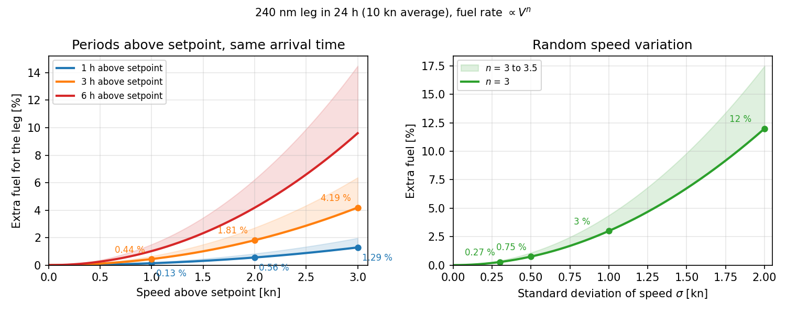
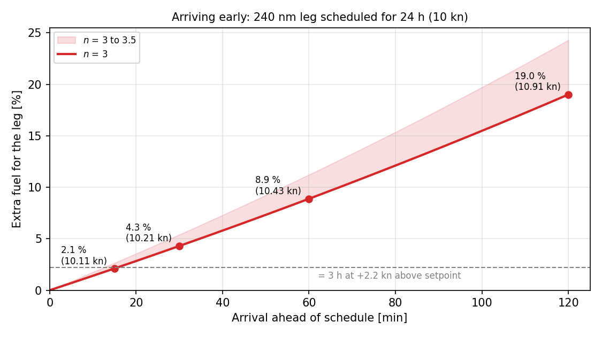
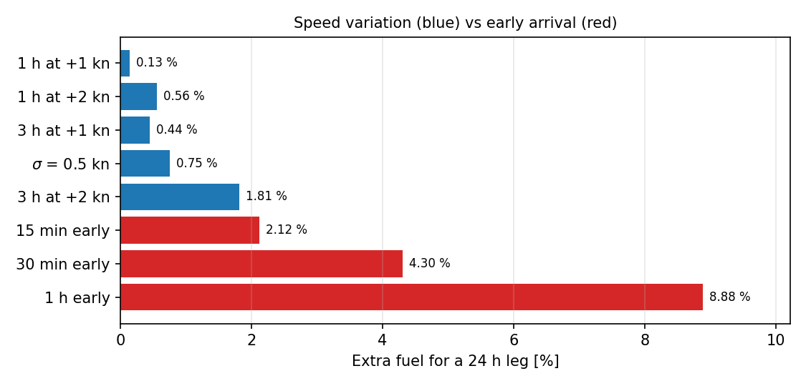

#+TITLE:
#+OPTIONS: title:nil toc:nil num:t H:3 ^:{}
#+LATEX_CLASS: article
#+LATEX_CLASS_OPTIONS: [a4paper,11pt]
#+LATEX_HEADER: % --- Document metadata (must precede bv.sty which uses them in \hypersetup) ---
#+LATEX_HEADER: \newcommand{\bvReferenceNumber}{XXXXXX}
#+LATEX_HEADER: \newcommand{\bvIssue}{Pre}
#+LATEX_HEADER: \newcommand{\bvTitle}{Propulsion Optimiser -- Delivery Options and Speed Control Savings}
#+LATEX_HEADER: \newcommand{\bvDate}{\today}
#+LATEX_HEADER: \newcommand{\bvType}{Technical Note}
#+LATEX_HEADER: \newcommand{\bvAuthor}{Frode Bloch}
#+LATEX_HEADER: \newcommand{\bvCompany}{Brunvoll AS}
#+LATEX_HEADER: \newcommand{\bvClassification}{CONFIDENTIAL}
#+LATEX_HEADER: \usepackage{/home/blofro/src/rdt_analysis/bv}
#+LATEX_HEADER: \usepackage{siunitx}
#+LATEX_HEADER: \sisetup{per-mode=symbol, inter-unit-product=\ensuremath{\cdot}}
#+LATEX_HEADER: \DeclareSIUnit{\knot}{kn}
#+LATEX_HEADER: \usepackage{amsmath}

#+BEGIN_EXPORT latex
\bvMainTitlePage
\tableofcontents
\newpage
#+END_EXPORT

* Introduction

This note summarises the delivery options for the Brunvoll Propulsion
Optimiser and quantifies the additional saving potential of the speed
control function.  It builds on the commissioning and in-service logs
from MV Link Galaxy (V2597), October--November 2026.

The Propulsion Optimiser is expected to save typically *1--4 % of
propulsion fuel compared with standard combinator operation*, depending
on operating profile, engine and plant.  On Link Galaxy the saving at
the normal service speed of 10--10.5 kn is approximately 1.5 %.

Speed control saves fuel by a different mechanism: it lets the vessel
sail at exactly the speed the schedule requires.  This saving is not
included in the 1--4 % and depends on how the vessel is operated.

* Experience from MV Link Galaxy

** Data

- Commissioning log, 31 October -- 2 November 2026 (about 49 h, 21 h
  with the Optimiser active).
- In-service log, 2 -- 11 November 2026 (9.6 days, 154 h of transit).

** Usage and performance

- In transit the Optimiser was active 94 % of the time and speed control
  was used 92 % of the time.
- Speed tracking: standard deviation 0.09 kn, 5--95 % range $-0.14$ to
  $+0.16$ kn.
- No alarms from the Optimiser or speed control during the in-service
  period.
- The remaining 6 % of transit was in fixed-rpm mode (Optimiser
  inactive by design).  12 of 14 fixed-rpm periods start at departure or
  end at arrival, typically 40--120 min at 6--13 kn: harbour approaches
  and narrow passages, probably related to tunnel thruster use (constant
  speed CP thrusters on the shaft generator).
- Normal service speed is 10--10.5 kn (speed setpoints: 47 h at 10.5 kn,
  36 h at 10.0 kn, 16 h at 8.5 kn, 30 h at 10.8--11.5 kn).  The
  commissioning trip at 8.5 kn was not representative.
- Handover to the Optimiser is bumpless: the setpoints equal the
  combinator output at activation in all nine logged handovers.  The
  visible transient comes from the mode change from fixed rpm to
  transit, where the same lever position gives clearly less thrust.  The
  crew compensates with the lever.
- Engine torque margin is large: while the Optimiser was active the load
  was below 64 % of the torque limit 99 % of the time, and never above
  93 %.  The overload warnings in the period all occurred with the
  combinator at full power.

** Saving

- Logged saving in the in-service period: 679 kg of 32.9 t, 2.06 %.
  This figure is too high, see below.  Corrected for the shaft generator
  load the saving is about 1.5--1.6 %.
- A re-run of the annual simulation with the actual combinator table,
  the shaft generator floor and the Wärtsilä approval SFOC curve gives
  0.9 % at 12.5 kn, 1.5 % at 10 kn and 1.7 % at 8.7 kn.
- The pre-commissioning simulations indicated 1.6 % at 12.5 kn and
  1.4 % at 10 kn.  The overall level agrees, but the speed dependence and
  the explanation have changed.

** Problems found

#+ATTR_LATEX: :align p{5.0cm}p{6.0cm}p{3.8cm} :font \footnotesize
| Problem                                                                                                                             | Effect                                                                                                         | Status                                    |
|-------------------------------------------------------------------------------------------------------------------------------------+----------------------------------------------------------------------------------------------------------------+-------------------------------------------|
| Shaft generator state and load only read from a simulator message, never on the vessel                                             | Rpm setpoint below the generator minimum speed (58 % of active time at 8.5 kn); generator load missing in fuel; saving shown 2--3 times too high at low load | Fixed in #13531, incl. direct =I_GeneratorLoad= signal |
| Engine load % treated as % of the engine envelope at current rpm (signal is % of 6000 kW)                                         | Load underestimated 1.5--2.2 times; sea-state margin always at its floor; power diagnostics wrong            | Fixed in #13531                           |
| SFOC map from Wärtsilä Project Guide 1997                                                                                         | 7--10 % optimistic; absolute fuel and kg saved too low                                                       | Replaced by Wärtsilä approval curve (#13531); reduced-rpm shape still borrowed from MAN L27/38 |
| Resistance blend below the lowest model test speed (10 kn)                                                                         | Resistance 20--37 kN too high at 8--9 kn; speed controller integrator carried about $-50$ kN; observer bias $-30$ to $-40$ kN | Fixed in #13552 (merged); simplification to pure $V^2$ pending |
| No speed log signal on board                                                                                                       | Speed through water from torque and GPS only; torque speed has ±0.5 kn pitch-dependent bias               | Installation omission; to be corrected   |
| Engine load signal appears fuel-rack based (offset at part load)                                                                   | Power diagnostics and generator load reconstruction unreliable; conservative for load control                | Raw torque and generator load added to CMS export to verify |
| Pitch transform / C4-40 series mismatch (actual EAR 0.435)                                                                         | Torque ratio 0.97--1.03 depending on pitch; small effect on saving                                           | Use CFD open-water data on future deliveries |
| Raw torque, generator load, modes and lever not in CMS export                                                                      | Several conclusions had to be inferred indirectly                                                             | Logging update requested                  |
| Pre-commissioning simulations: assumed combinator, 750 rpm engine basis, Holtrop resistance                                       | Saving distribution over speed wrong                                                                           | Re-run with actual combinator and SFOC; to be updated |
| VBW speed log sentences: water speed validity flag not exposed (general, found during review)                                     | Speed through water 0 kn reported as valid when a Doppler log only has bottom track                          | Issue to be created                       |

Despite these errors the system worked well in practice: the speed
controller's integrator absorbed the resistance error, and the
optimisation itself is insensitive to most model errors.  The errors
mainly affected the reported saving, the margins and the diagnostics.

** Lessons learned

- Logging is essential: every problem above was found from logs.
- Signals from gear control must be verified on the actual vessel, not
  only in the simulator.
- The SFOC map is the most important input, and data at reduced rpm and
  low load must be requested from the engine maker early.
- The resistance curve should cover the lowest transit speed.

* Suggested delivery options

The following delivery options are suggested for future vessels, based
on the Link Galaxy experience.

** Standard

The Standard package contains the Propulsion Optimiser with speed
control, and requires no sensors beyond those already on board.

Required interfaces:
- Gear control (propulsion modes, combinator, shaft generator state and
  load, engine load).  Always available in the Brunvoll control system.
- Speed log (speed through water) and GPS.  Both mandatory on board.
- Data logging to CMS with export to shore.  Required for
  commissioning, support and documentation of the saving.

Input data, with the fallback used when the preferred data are not
available.  The effect on the saving estimate is approximate and based on
the Link Galaxy analysis:

#+ATTR_LATEX: :align p{2.6cm}p{4.0cm}p{3.6cm}p{4.6cm} :font \small
| Input                     | Preferred                                      | Fallback                                 | Effect of fallback                                                   |
|---------------------------+------------------------------------------------+------------------------------------------+----------------------------------------------------------------------|
| Propeller                 | CFD open-water data ($K_T$, $K_Q$ vs $J$)      | Wageningen C/D series                    | Saving ±0.1--0.2 pp                                              |
| Resistance, $w$, $t$, $\eta_R$ | Model test report or CFD                  | Holtrop--Mennen                          | Saving ±0.1 pp; poorer speed-control feedforward and diagnostics |
| Engine SFOC               | Engine maker's map incl. reduced rpm           | Rated-rpm curve + generic shape, or generic | Saving ±0.3--0.5 pp or more; absolute fuel ±5--10 %       |

The engine SFOC data have the largest influence on the saving.  The
request for an SFOC map including reduced rpm and low load should be
part of the yard's engine specification at contract stage.

For new propeller designs, CFD open-water data and model test or CFD
hull data are normally available at no extra cost.

** Extra

The Extra options do not change the saving significantly, but add
monitoring, verification and the fuel limit function:

#+ATTR_LATEX: :align p{3.2cm}p{3.2cm}p{8.4cm} :font \small
| Option                   | Effect on saving                | Value                                                                                       |
|--------------------------+---------------------------------+---------------------------------------------------------------------------------------------|
| Shaft torque sensor      | < 0.1 pp                        | Verified engine and shaft power, propeller fouling indication, cross-check of load signals |
| Main engine fuel flow    | None directly                   | Maximum fuel flow limit, measured fuel, verified saving (on/off tests), propulsion data for MRV/DCS |
| Torque + fuel flow       | Indirectly via verified SFOC map | Measured SFOC map and engine condition trend                                               |

The data from the Extra options are best analysed on shore, as part of
a performance service: periodic reports of verified saving, propeller,
hull and engine condition, and controlled updates of the SFOC map.

* Speed control saving potential

The examples below are for a 240 nm leg scheduled for 24 h at an
average speed of 10 kn.  The fuel rate is assumed proportional to
$V^3$.  At higher speeds the exponent increases (wave-making resistance,
engine load), so the larger deviations are somewhat underestimated.

** Speed variation at equal arrival time

The vessel sails above the setpoint for part of the leg and slower for
the rest, arriving at the scheduled time.

| Deviation              | +1 kn   | +2 kn   | +3 kn   |
|------------------------+---------+---------+---------|
| 1 h above setpoint     | +0.13 % | +0.56 % | +1.29 % |
| 3 h above setpoint     | +0.44 % | +1.81 % | +4.19 % |

For random speed variation with standard deviation $\sigma$ around the
average, the extra fuel is $3\sigma^2/\bar{V}^2$:

| $\sigma$    | 0.3 kn  | 0.5 kn  | 1 kn   | 2 kn  |
|-------------+---------+---------+--------+-------|
| Extra fuel  | +0.27 % | +0.75 % | +3.0 % | +12 % |

The penalty grows with the square of the deviation.  Normal speed
variations cost a few tenths of a percent.

#+CAPTION: Extra fuel from speed variation at equal arrival time.  Left: periods above the setpoint.  Right: random variation.  The bands show fuel rate exponents $n$ = 3 to 3.5.
#+ATTR_LATEX: :width \textwidth

** Arriving early

Arriving early means a higher average speed than required.  The fuel
for the leg is proportional to $V^2$.  Fuel while waiting is not
included.

| Arrives early by | Average speed | Extra fuel for the leg |
|------------------+---------------+------------------------|
| 15 min           | 10.11 kn      | +2.1 %                 |
| 30 min           | 10.21 kn      | +4.3 %                 |
| 1 h              | 10.43 kn      | +8.9 %                 |
| 2 h              | 10.91 kn      | +19 %                  |

Arriving only 15 minutes early costs as much as sailing 3 h at 2.2 kn
above the setpoint.

#+CAPTION: Extra fuel from arriving early, 240 nm leg scheduled for 24 h.  The band shows fuel rate exponents $n$ = 3 to 3.5.
#+ATTR_LATEX: :width 0.8\textwidth

#+CAPTION: Speed variation compared with early arrival, 24 h leg at 10 kn average.
#+ATTR_LATEX: :width 0.8\textwidth

** Interpretation

- The main saving potential of speed control is not tighter speed
  tracking, but the ability to sail at exactly the speed the schedule
  requires, without a margin for drifting speed.
- Rule of thumb: every 15 minutes of unnecessary arrival margin on a
  24-hour leg costs about 2 % fuel.  Every 0.1 kn of unnecessary speed
  at 10 kn costs about 2 %.
- Part of the arrival margin covers real voyage uncertainty (weather,
  pilot and berth times, tides).  Speed control removes the
  speed-holding uncertainty, not the voyage uncertainty.
- The saving depends on how the vessel was operated before.  It should
  be documented per vessel from arrival times and average speeds before
  and after installation.
- On Link Galaxy the crew uses speed control more than 90 % of the
  transit time and holds the setpoint within ±0.1 kn.
- A natural extension is an ETA hold function, where the speed setpoint
  is calculated from distance to go and the required arrival time.

* Summary

- Propulsion Optimiser: typically 1--4 % of propulsion fuel compared with
  standard combinator operation.  No extra sensors required.
- Speed control: additional saving that depends on operation; about 2 %
  per 15 minutes of unnecessary arrival margin on a 24-hour leg.
- Torque sensor and fuel flow meter are optional, and add verified power,
  verified saving, engine and propeller monitoring, and the fuel limit
  function.
