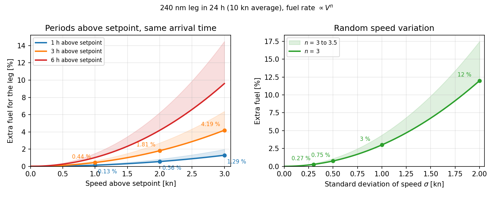
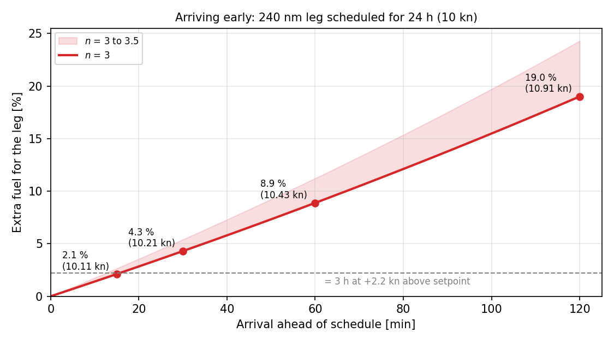
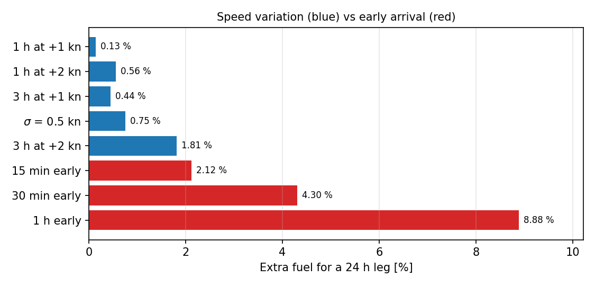

#+TITLE:
#+OPTIONS: title:nil toc:nil num:t H:3 ^:{}
#+LATEX_CLASS: article
#+LATEX_CLASS_OPTIONS: [a4paper,11pt]
#+LATEX_HEADER: % --- Document metadata (must precede bv.sty which uses them in \hypersetup) ---
#+LATEX_HEADER: \newcommand{\bvReferenceNumber}{XXXXXX}
#+LATEX_HEADER: \newcommand{\bvIssue}{Pre}
#+LATEX_HEADER: \newcommand{\bvTitle}{Speed Strategies, Ocean Current and Fuel Cap -- Rotterdam--Gothenburg}
#+LATEX_HEADER: \newcommand{\bvDate}{\today}
#+LATEX_HEADER: \newcommand{\bvType}{Technical Note}
#+LATEX_HEADER: \newcommand{\bvAuthor}{Frode Bloch}
#+LATEX_HEADER: \newcommand{\bvCompany}{Brunvoll AS}
#+LATEX_HEADER: \newcommand{\bvClassification}{CONFIDENTIAL}
#+LATEX_HEADER: \usepackage{/home/blofro/src/rdt_analysis/bv}
#+LATEX_HEADER: \usepackage{siunitx}
#+LATEX_HEADER: \sisetup{per-mode=symbol, inter-unit-product=\ensuremath{\cdot}}
#+LATEX_HEADER: \DeclareSIUnit{\knot}{kn}
#+LATEX_HEADER: \usepackage{amsmath}

#+BEGIN_EXPORT latex
\bvMainTitlePage
\tableofcontents
\newpage
#+END_EXPORT

* Introduction

A ship owner has asked for a maximum fuel flow limit (fuel cap) in the
Propulsion Optimiser.  This note examines whether a fuel cap saves fuel
compared with the speed control function, when the vessel must arrive
at a fixed time.  It also quantifies the potential of speed profiles
planned with knowledge of current and weather, and summarises the
general fuel effect of speed variation and early arrival.

* Simulation

** Route and vessel

- Route Rotterdam Europoort -- Gothenburg (509 nm, 7 legs), both
  directions, one departure per day through 2024 (about 360 voyages
  per direction).
- Nominal speed 10 kn; every strategy arrives at the scheduled time
  (about 51 h).
- Vessel model as in the earlier voyage studies for this route: hull
  model test data, Wageningen C4 propeller with the Propulsion Optimiser
  choosing pitch and rpm, MAN L27/38 engine map, Flettner rotor
  (H = 28 m, D = 4 m, spin ratio 3; spun only when it improves thrust
  over the stopped rotor).  The rotor's electric drive motor is assumed
  supplied by an auxiliary generator at 215 g/kWh, and this fuel is
  included in the voyage fuel.  No shaft generator load.

** Environment

- Waves and wind: NORA3 hindcast (MET Norway), hourly.  Wave added
  resistance from strip theory, hull wind resistance from Blendermann
  coefficients.
- Current: Copernicus Marine Service North-West European Shelf physics
  reanalysis, hourly surface current at about 7 km resolution, tides
  included (product ID in Section 6).  The mean along-track current
  magnitude was 0.37--0.38 kn, strongest off the Dutch coast (95th
  percentile about 1.7 kn).

** Method

- The route is divided into about 100 segments of 5 nm.  For each
  segment the fuel rate is computed as a function of speed through
  water from calm-water resistance, waves, wind and rotor thrust, using
  the optimiser's minimum-fuel pitch and rpm.
- Only the along-track current component is used; the drift angle from
  cross current is ignored.
- Weather and current at each segment are taken at the scheduled time;
  the strategies reach a segment within a few minutes of each other.
- Each voyage's fuel is corrected to the exact scheduled arrival time.
- The optimised strategies assume perfect knowledge of current and
  weather for the whole voyage, taken from the hindcast.  In practice
  the speed profile must be planned from forecasts and updated during
  the voyage, so the optimised results are an upper bound on what can be
  achieved.  Tidal currents are well predicted, so the current-only
  result should be close to achievable; the weather-dependent part
  depends on forecast quality.

** Strategies

All strategies arrive at the same time.

#+ATTR_LATEX: :align p{4.2cm}p{10.4cm} :font \small
| Strategy                        | Description                                                                                     |
|---------------------------------+-------------------------------------------------------------------------------------------------|
| Constant SOG (speed control)    | Reference: constant speed over ground                                                          |
| Constant STW                    | Constant speed through water (approximately constant power)                                   |
| Optimised, current known        | Speed profile minimising fuel with known current, calm-water fuel model                       |
| Optimised, current + weather    | Speed profile minimising fuel with known current, waves and wind                              |
| Fuel cap $k\times$              | Speed control, with speed reduced where the fuel rate would exceed $k$ times the calm-water fuel rate at 10 kn; the lost time is made up by a uniformly higher speed elsewhere |

* Results

Fuel relative to constant speed over ground (speed control), same
arrival time, with the Flettner rotor.  Values in brackets are the same
simulation without the rotor.  Cap results exclude voyages where the
cap made the schedule impossible.

#+ATTR_LATEX: :align p{5.6cm}p{2.6cm}p{2.6cm}p{3.2cm} :font \small
| Strategy                              | Rotterdam to Gothenburg | Gothenburg to Rotterdam | Voyages where schedule cannot be met |
|---------------------------------------+------------------------+------------------------+--------------------------------------|
| Constant SOG (speed control)          | 0                      | 0                      | --                                   |
| Constant STW                          | +0.04 % (+0.10)        | +0.04 % (+0.10)        | --                                   |
| Optimised, current known              | -0.14 % (-0.12)    | -0.17 % (-0.13)    | --                                   |
| Optimised, current + weather known    | *-0.58 %* (-0.19)  | *-0.63 %* (-0.19)  | --                                   |
| Fuel cap 1.1$\times$                  | +0.09 % (-0.01)      | +0.11 % (-0.03)      | 136 / 92 of about 360                |
| Fuel cap 1.2$\times$                  | +0.09 % (+0.09)        | +0.18 % (+0.01)        | 76 / 42                              |
| Fuel cap 1.3$\times$                  | +0.12 % (+0.07)        | +0.16 % (+0.05)        | 45 / 23                              |
| Fuel cap 1.5$\times$                  | +0.16 % (+0.09)        | +0.12 % (+0.10)        | 16 / 7                               |

Observations:
- A fuel cap does not save fuel at a fixed arrival time; it costs
  0.1--0.2 % compared with speed control.  The cap slows the vessel
  wherever the fuel rate is high, including in head current where the
  optimum is to speed up, and the lost time is made up where speed is
  not particularly cheap.
- A tight cap makes the schedule impossible in heavy weather on a large
  share of voyages (more than one third at 1.1$\times$).
- Planning the speed with knowledge of current alone gains about
  0.15 % (upper bound, perfect knowledge).  With the Flettner rotor, planning with current and weather
  gains about 0.6 % on average, and 1--1.4 % on the 10 % most
  favourable voyages: the optimum sails faster when the rotor is
  effective and slower in head wind.  Both are upper bounds, as the
  simulation assumes perfect knowledge of the conditions.
- A fuel cap may still be wanted for other purposes, such as limiting
  engine load, staying within a consumption budget, or deliberately
  accepting later arrival in bad weather.

* Speed control saving potential

The examples below are for a 240 nm leg scheduled for 24 h at an
average speed of 10 kn.  The fuel rate is assumed proportional to
$V^3$.  At higher speeds the exponent increases (wave-making resistance,
engine load), so the larger deviations are somewhat underestimated.

** Speed variation at equal arrival time

The vessel sails above the setpoint for part of the leg and slower for
the rest, arriving at the scheduled time.

| Deviation              | +1 kn   | +2 kn   | +3 kn   |
|------------------------+---------+---------+---------|
| 1 h above setpoint     | +0.13 % | +0.56 % | +1.29 % |
| 3 h above setpoint     | +0.44 % | +1.81 % | +4.19 % |

For random speed variation with standard deviation $\sigma$ around the
average, the extra fuel is $3\sigma^2/\bar{V}^2$:

| $\sigma$    | 0.3 kn  | 0.5 kn  | 1 kn   | 2 kn  |
|-------------+---------+---------+--------+-------|
| Extra fuel  | +0.27 % | +0.75 % | +3.0 % | +12 % |

The penalty grows with the square of the deviation.  Normal speed
variations cost a few tenths of a percent.

#+CAPTION: Extra fuel from speed variation at equal arrival time.  Left: periods above the setpoint.  Right: random variation.  The bands show fuel rate exponents $n$ = 3 to 3.5.
#+ATTR_LATEX: :width \textwidth

** Arriving early

Arriving early means a higher average speed than required.  The fuel
for the leg is proportional to $V^2$.  Fuel while waiting is not
included.

| Arrives early by | Average speed | Extra fuel for the leg |
|------------------+---------------+------------------------|
| 15 min           | 10.11 kn      | +2.1 %                 |
| 30 min           | 10.21 kn      | +4.3 %                 |
| 1 h              | 10.43 kn      | +8.9 %                 |
| 2 h              | 10.91 kn      | +19 %                  |

Arriving only 15 minutes early costs as much as sailing 3 h at 2.2 kn
above the setpoint.

#+CAPTION: Extra fuel from arriving early, 240 nm leg scheduled for 24 h.  The band shows fuel rate exponents $n$ = 3 to 3.5.
#+ATTR_LATEX: :width 0.8\textwidth

#+CAPTION: Speed variation compared with early arrival, 24 h leg at 10 kn average.
#+ATTR_LATEX: :width 0.8\textwidth

** Interpretation

- The main saving potential of speed control is not tighter speed
  tracking, but the ability to sail at exactly the speed the schedule
  requires, without a margin for drifting speed.
- Rule of thumb: every 15 minutes of unnecessary arrival margin on a
  24-hour leg costs about 2 % fuel.  Every 0.1 kn of unnecessary speed
  at 10 kn costs about 2 %.
- Part of the arrival margin covers real voyage uncertainty (weather,
  pilot and berth times, tides).  Speed control removes the
  speed-holding uncertainty, not the voyage uncertainty.
- The saving depends on how the vessel was operated before.  It should
  be documented per vessel from arrival times and average speeds before
  and after installation.
- A natural extension is an ETA hold function, where the speed setpoint
  is calculated from distance to go and the required arrival time.

* Conclusions

- With a fixed arrival time, a fuel cap gives no fuel saving compared
  with speed control on this route (+0.1--0.2 %), and a tight cap
  compromises the schedule.
- The fuel benefit the owner is looking for is better obtained by
  planned speed: ETA hold, extended with current and weather forecasts.
  With a Flettner rotor and perfect knowledge of current and weather this
  is worth about 0.6 % on this route; with real forecasts the gain will
  be lower.
- The largest speed-related saving is to avoid sailing faster than the
  schedule requires (Section 4): about 2 % per 15 minutes of unnecessary
  arrival margin on a 24 h leg.

* Data sources and acknowledgement

- This study has been conducted using E.U. Copernicus Marine Service
  Information; https://doi.org/10.48670/moi-00059.  Product: Atlantic --
  European North West Shelf -- Ocean Physics Reanalysis, product ID
  =NWSHELF_MULTIYEAR_PHY_004_009=, dataset
  =cmems_mod_nws_phy-uv_my_7km-2D_PT1H-i=.
- Wave and wind data: NORA3 hindcast, Norwegian Meteorological Institute
  (MET Norway), licensed under CC BY 4.0.
